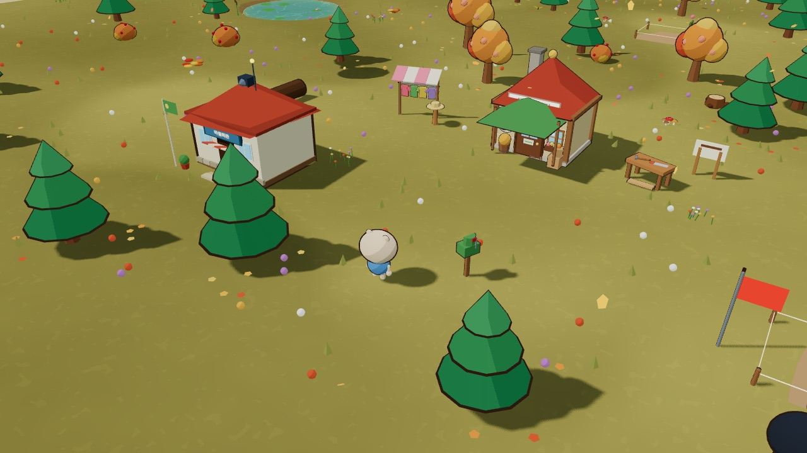
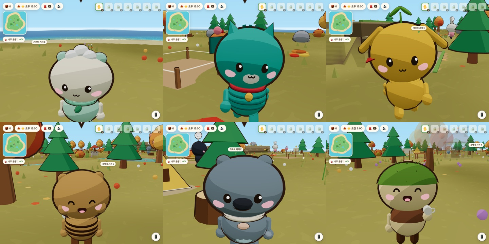

# 도토리섬

현실 시계를 따라 하루가 흐르는 작은 섬에서 채집하고, 팔고, 주민과 친해지고, 집을 지어 새 이웃을 맞고, 가구와 꽃으로 섬을 꾸미는 힐링 생활 시뮬레이션입니다. 모델은 에셋 파일 없이 Three.js 기본 도형으로 만들고, 3단 셀 셰이딩과 테두리선으로 동글동글한 느낌을 냅니다.

바로 해 보기: https://dotori-isle.vercel.app (데스크톱 브라우저 권장. 저장은 브라우저에 남습니다.)





## 빠른 길잡이 — 주요 절 바로가기

- **처음 보는 분**: [실행](#실행--설치-명령--개발-쿼리-고정) · [조작](#조작--키-표--터치-버튼-배치) · [첫 화면 알림](#첫-화면-알림--아침-소식은-첫-흔들기-뒤--시작-토스트-없음--첫-목표-화살표) · [게임 안 휴대폰](#게임-안-휴대폰--앱-격자--단축키-화면--알림--카메라-잠금) · [터치 기기](#터치-기기--휴대폰-한-곳--44px-이상-칸--미니맵-탭으로-지도)
- **섬 생활**: [핵심 루프](#핵심-루프--채집--판매--도구-구매) · [도구](#도구--동작-모션과-하루-채집-한도) · [상호작용 우선순위](#상호작용-우선순위--가까운-실제-행동-먼저-안내는-마지막) · [도토리 마일리지](#도토리-마일리지--섬-생활-업적--교환소) · [펠리컨 여행](#펠리컨-여행--오렌지-섬-왕복)
- **주민**: [주민 수다](#주민-수다--성격별-말투--상황-보고-화제-고르기--질문과-대답) · [주민과 꾸미기](#주민과-꾸미기--호감도--하루-부탁--가구-배치) · [주민 생일과 선물](#주민-생일과-선물--취향--하루-한-번--답례-편지) · [주민에게 편지 쓰기](#주민에게-편지-쓰기--80자--편지지-세-종--사흘-안의-답장) · [주민 옷 바꿔 입기](#주민-옷-바꿔-입기--선물한-다음-날부터--취향별-반응)
- **상점과 집**: [상점·집·ATM](#상점집atm--도토리-경제-세-칸--대출-무이자--다-갚아야-다음-단계) · [도토리 상점 실내](#도토리-상점-실내--점원-가람나루--atm-이전--단계별-진열--공사와-재개장) · [도토리 백화점](#도토리-백화점--2층-외관--금요일-반짝-할인--이달의-가구--주인의-기억) · [방 크기와 층](#방-크기와-층--단계별-방--다락-사다리와-옆방지하실-이동--층별-가구) · [집 안 가구](#집-안-가구--쓰임별-e-행동--흔들림-반응--주민-방-물건) · [정원 꾸미기](#정원-꾸미기--허가-한-번--울타리-세-종-이음--바닥-세-종) · [집 꾸미기 점수](#집-꾸미기-점수--월요일-편지--100점-만점--구간-보상)
- **계절 행사와 장**: [호박 등불 밤](#호박-등불-밤--10월-31일-17시부터--등불과-망토--사탕-교환) · [도토리 감사 장날](#도토리-감사-장날--11월-셋째-주-토요일--수확물-나눔--답례-가구) · [토요일 장터](#토요일-장터--떠돌이-상인--장날마다-한-번씩-사기) · [일요일 낚시 대회](#일요일-낚시-대회--3분-판--마릿수-포인트--대회-상품) · [송이 시세](#송이-시세--일요일-상인--주-단위-시세-네-패턴--다음-일요일에-상함)
- **이야기와 목표**: [섬 이야기](#섬-이야기--5장--기존-조건-재사용--예전-저장-따라잡기) · [이번 주 목표](#이번-주-목표--매주-세-개--주-시작-대비-증가분--마일리지와-주간-보상) · [기능 열림 순서](#기능-열림-순서--첫날-기본만--조건-충족-시-소개-편지-한-번)
- **구조와 확인**: [저장 이행 안전장치](#저장-이행-안전장치--버전-29--실패-때-백업-키--최근-세-개) · [구조](#구조--순수-로직과-렌더-분리) · [QA 방법](#qa-방법--playwright-gpu-스크립트--중간-진행-상태--첫-플레이-검증) · [브라우저 확인](#브라우저-확인--헤드리스-webgl)

## 실행 — 설치 명령 · 개발 쿼리 고정

```bash
pnpm install
pnpm dev          # http://localhost:5173
pnpm test         # core 로직 테스트
pnpm build
```

`?hour=21` 처럼 쿼리를 붙이면 섬의 시각을 고정합니다. 밤에만 나오는 벌레·물고기를 확인할 때 씁니다. `?weather=rain`(`sunny`·`cloudy`)은 날씨를 고정합니다. 이 쿼리들은 개발 빌드에서만 읽고, 배포 빌드에서는 무시합니다(`devParam`).

## 조작 — 키 표 · 터치 버튼 배치

| 키 | 동작 |
|---|---|
| WASD · 방향키 | 이동 (Shift 달리기) |
| E · Space | 줍기 · 나무 흔들기 · 벌레 잡기 · 낚시 · 상점 · 대화 · 가구 넣기 · 집 짓기 · 작업대 · 펠리컨 · 옷 가판대 · 편지함 · 사다리로 오르내리기 · 도구 쓰기 |
| 주머니의 가구·꽃씨 칸 클릭 | 배치 시작 (E 놓기·심기 · R 돌리기 · Esc 그만두기) |
| 1~7 · Q · 도구 아이콘 클릭 | 맨손 · 잠자리채 · 낚싯대 · 삽 · 물뿌리개 · 도끼 · 사다리 |
| Tab | 도감 |
| J | 퀘스트 수첩 |
| M | 도토리 마일리지 |
| C | 옷장 |
| R | 앉기·켜기 되는 가구 넣기 (배치 중에는 돌리기) |
| 마우스 휠 · 두 손가락 | 카메라 당기기 · 밀기 |
| I | 주머니 |
| N | 섬 전체 지도 |
| P | 사진 모드(Esc 나 P 로 나감) |
| `` ` `` | 휴대폰 열고 닫기 |
| Esc | 창 닫기 |

터치 기기에서는 왼쪽 아래 조이스틱과 오른쪽 아래 E·도구·📱 휴대폰 버튼이 나타납니다. 조이스틱을 끝까지 밀면 달립니다. 휴대폰과 칸 크기는 「게임 안 휴대폰」과 「터치 기기」 절에 적었습니다.

## 첫 화면 알림 — 아침 소식은 첫 흔들기 뒤 · 시작 토스트 없음 · 첫 목표 화살표

첫날 화면에 알림이 한꺼번에 쌓이지 않도록 알림의 시점을 나눴습니다.

- 첫날 아침 소식 카드는 첫 흔들기를 하기 전까지 미룹니다. 첫 흔들기를 하면 그때 카드가 나옵니다(`MorningNews`의 `hold`, 퀘스트 `FIRST_QUEST`).
- 시작할 때 뜨던 토스트는 없앴습니다. 목표 알약과 겹쳐 두 안내가 서로 가렸기 때문입니다.
- 첫 흔들기 전에는 가장자리 화살표 글자를 33px로 키우고 천천히 맥박치게 합니다(`.shake-hint.first .shake-edge`). 목표 알약의 툴팁은 "열매 나무 가까이 가서 E"로 안내합니다(`ShakeHint`, `.shake-hint.first`, `SHAKE_TIP`).

## 게임 안 휴대폰 — 앱 격자 · 단축키 화면 · 알림 · 카메라 잠금

HUD 오른쪽 아래의 📱 버튼이나 ` 키로 휴대폰을 엽니다(`PhoneButton`, `controls.ts` 의 `Backquote`). 예전 ☰ 메뉴의 항목은 모두 여기로 옮겼고, ☰ 메뉴는 없앴습니다.

- 앱 목록은 `phoneApps` 가 정합니다. 미션, 도감, 지도, 마일리지, 달력, 섬 살림, 카메라, 사진 앨범, 옷장, 마이 디자인, 꾸미기 점수, 송이 상인, 단축키, 설정, 알림 순서입니다. 섬 살림은 상점·집·통장·이번 주 목표를 한 화면에 모은 앱입니다. 꾸미기 점수는 집 안에서만, 송이 상인은 일요일에만 나옵니다.
- 섬 살림 화면에 증축 중인 집이 있으면 `🏠 ○○네 집 증축 · 남은 도토리 N개` 줄을 붙이고, 값이 다 차면 `내일 아침에 완성돼요`를 보여 줍니다(`expandRow`).
- 카메라 앱은 사진 모드(`systemOpen('photo')`)가 열리기 전에는 잠긴 채 보이고, 누르면 열리는 조건을 알려 줍니다(`locked`).
- 앱을 누르면 기존 패널을 그대로 엽니다(`runApp`). 사진은 사진 모드를, 앨범과 옷장은 각자의 패널을 엽니다.
- 단축키와 알림은 휴대폰 안의 화면입니다. 단축키 화면은 조작 키 목록을, 알림 앱은 쌓인 알림 기록을 보여 주고, 안 본 알림 수를 배지로 띄웁니다(`noticeLog`, `noticeSeen`).
- 미션 앱의 배지는 받을 보상 수를 숫자로 보여 줍니다. 이번 주 목표가 남았으면 숫자 없이 작은 점만 찍습니다(`badge-dot`, `weeklyLeft`).
- 열린 휴대폰은 Esc 로 닫고, Tab 은 기기 안에서만 돕니다(`Phone`).

## 터치 기기 — 휴대폰 한 곳 · 44px 이상 칸 · 미니맵 탭으로 지도

터치 기기에서 흩어져 있던 메뉴와 누르는 칸을 한곳에 모았습니다. 예전 ☰ 메뉴는 없애고 📱 휴대폰으로 옮겼습니다.

- 퀘스트·도감·마일리지·카메라 같은 기능은 📱 휴대폰 한 곳에서 엽니다. 설정 창의 조작 안내에도 같은 내용을 적었습니다(`TouchControls`, `PhoneButton`).
- 누르는 칸은 44px 이상으로 키웠습니다. 알약 칩과 잠긴 도구 칸이 대상입니다(`styles.css` 터치 규칙).
- ATM·집 상담의 버튼과 금액 칸, 설정의 슬라이더·품질·저장 버튼, ✋ 도구 칸도 44px 이상입니다. 맨 끝의 `pointer: coarse` 블록에서만 키워 데스크톱 모양은 그대로입니다.
- 미니맵을 탭하면 전체 지도가 열립니다.

## 타이틀 화면 — 궤도 카메라 · 이어하기 판정 · 1.2초 하강

처음 열면 섬이 뒤에서 천천히 돌고, 로고와 시작 버튼이 나옵니다. 클릭, Enter, Space 중 하나로 시작합니다(`Title`, `TitleCam`).

- 저장이 있고 하루가 지났거나 무언가 한 흔적이 있을 때만 '이어하기 · N일째'로 봅니다. 처음 열면 빈 저장이 먼저 만들어지므로 그때는 '새로 시작'입니다.
- 시작을 누르면 카메라가 1.2초 동안 플레이어 뒤쪽 평소 시점으로 내려옵니다. 그동안 입력은 막습니다(`endTitle`, `GLIDE_SECONDS`).
- 타이틀 중에는 나무 안내 말풍선, 📱 휴대폰 버튼, 주민 말풍선, 절벽 테두리를 숨깁니다. 시간대와 날씨는 저장된 날짜를 따릅니다.

## 설정 창 — 그래픽 품질 · 소리 두 줄 · 저장 파일

📱 휴대폰의 ⚙️ 설정 앱에서 엽니다(`SettingsPanel`).

- 그래픽 품질은 높음·보통·낮음 세 단계입니다. 높음은 픽셀 비율 최대 2에 그림자를 켜고, 보통은 최대 1.5, 낮음은 픽셀 비율 1에 그림자를 끄고 풀을 절반으로 줄입니다(`PROFILES`).
- 배경음과 효과음 크기를 따로 조절합니다. 이 설정은 기기에 남습니다(`SoundSliders`).
- 저장 내보내기는 지금 저장을 JSON 파일로 내려받습니다. 가져오기는 파일을 검사한 뒤 덮어쓸지 한 번 더 묻습니다(`exportSaveFile`, `parseSaveFile`).
- 백업 목록은 최근 세 개를 보여 줍니다. 되살리기는 한 번 누르면 확인 문구로 바뀌고, 한 번 더 눌러야 실제로 되살립니다. 되살린 뒤에는 새로고침합니다(`listBackups`, `restoreBackup`).
- 같은 파일을 다시 골라도 가져오기가 동작합니다. 고른 뒤 입력 값을 비우기 때문입니다.
- 처음부터 다시는 확인 창을 한 번 더 거친 뒤에만 지웁니다.

## 저장 이행 안전장치 — 버전 29 · 실패 때 백업 키 · 최근 세 개

저장 버전은 29입니다. 이행 함수(`migrateSave`)가 던진 오류는 zustand 가 조용히 삼키므로, `loadSave` 가 직접 잡습니다.

- 이행이 실패하면 원본 글을 `dotori-isle-backup-버전-시각` 키에 남기고 기본 상태로 시작합니다. 이때 안내 토스트를 한 번 띄웁니다(`loadSave`, `backupSave`, `loadFailed`).
- 백업은 최근 세 개만 남기고 나머지는 지웁니다(`BACKUP_KEEP`). 설정의 백업 목록은 이 키들을 읽습니다.
- 돈·날짜·배열 칸은 값이 맞지 않으면 기본값으로 되돌립니다. 가구 칸의 색 변형과 옛 `paper-lantern` 칸도 이행에서 정리합니다(`cleanVariants`, `migrateItemIds`).
- 버전을 올린 기록은 이렇습니다. 27은 무지개 기록(`rainbowSeen`), 28은 가구 세트 완성 목록(`setsDone`), 29는 집 바깥 색(`homePaint`)입니다. 정원 칸(`gardenPermit`, `gardenTiles`)은 선택 칸이라 버전을 올리지 않았습니다.
- 처음부터 다시·되살리기·덮어쓰기는 저장 키를 바꾼 뒤 저장 쓰기를 멈춥니다. 새로고침 전에 스토어가 옛 상태를 다시 쓰면 방금 지운 저장이 되살아나기 때문입니다(`pauseSaveWrites`, `guardedLocal`). 되살리기가 실패하면 쓰기를 멈추지 않습니다.
- 이행과 불러오기 실패를 확인하는 테스트가 함께 돕니다(`saveMigrate.test.ts`, `loadSave.test.ts`, `saveFile.test.ts`).

## 핵심 루프 — 채집 · 판매 · 도구 구매

1. 맨손으로 과일나무를 흔들어 복숭아를 떨어뜨리고, 해변에서 조개를 줍습니다.
2. 상점에서 팔아 도토리를 모읍니다.
3. 잠자리채와 낚싯대(각 150)를 사면 벌레와 물고기를 잡을 수 있습니다.
4. 처음 잡은 종은 도감에 올라갑니다.

## 도구 — 동작 모션과 하루 채집 한도

| 도구 | 대상 | 결과 |
|---|---|---|
| 맨손 | 과일나무 | 두 팔로 줄기를 잡고 흔들면 복숭아 3개가 떨어지고 잎이 흩날립니다(하루 1번). |
| 잠자리채 | 날아다니는 벌레 | 휘둘러 잡습니다. |
| 낚싯대 | 모래사장에서 바다 쪽 | 찌가 쏙 들어갈 때 당깁니다. |
| 삽 | 바위 · 반짝이는 X 자리 · 땅 · 구멍 · 그루터기 | 바위를 다섯 번 두드리면 돌멩이·철광석·금광석이 튀어나와 깨지고, 바위는 다음 날 다시 생깁니다(`HITS_PER_ROCK`). 날마다 새로 뽑히는 아홉 곳의 X 자리를 파면 화석·도토리 꾸러미 등이 나옵니다(`digs`). 그 밖의 땅은 어디서나 구멍을 팔 수 있고, 판 구멍은 E 로 메웁니다. |
| 물뿌리개 · 넓은 · 큰 | 심은 꽃 | 물줄기를 뿌려 그날 물을 준 꽃으로 만듭니다. 넓은(2×2)·큰(3×3) 물뿌리개는 정사각형 안의 꽃을 한 번에 적십니다(아래 범위 절). |
| 도끼 | 나무 · 바위 | 나무에서 목재가 나옵니다(나무당 하루 3번). 다 벤 나무도 두 번 더 베면 넘어갑니다. |
| 사다리 | 절벽 앞 | 바라보는 쪽의 절벽 띠 너머 다른 높이의 평지로 오르내립니다(1.1초). 상점에서 120 도토리에 삽니다. |

바위·나무·땅에서 나온 물건은 실제 모양(물고기, 벌레, 과일, 통나무, 광석, 화석 등)으로 출발 지점에서 포물선을 그리며 튀어나와 두 번 통통 튄 뒤 둥실 떠 있습니다. 주우면 몸을 숙여 손으로 집고, 물건이 머리 위로 쏙 올라가며 주머니로 들어갑니다. 벌레와 물고기는 잡으면 머리 위로 크게 들어 보입니다. 효과음은 WebAudio 로 합성하고, 왼쪽 위 스피커 버튼으로 끌 수 있습니다.

동작마다 오른손 도구와 왼팔·몸 기울기를 따로 움직입니다. 들어올렸다 내려치고 반동으로 튕기는 식으로 구간을 나누고, 흙·불꽃·나무 조각·물방울·나뭇잎·색종이 파티클을 InstancedMesh 하나로 그립니다.

## 물뿌리개 범위 — 1 칸 · 2×2 · 3×3 정사각형

물뿌리개는 `canLevel`(1·2·3)으로 단계를 가지고, 범위는 `src/core/watering.ts` 가 정합니다. 꽃은 정수 칸에 심으므로 범위도 칸 단위이고, 바라보는 방향은 상하좌우 가장 가까운 쪽으로 맞춥니다. 2×2 는 바로 앞 두 줄, 3×3 은 한 칸 앞이 가운데인 정사각형입니다. 1 칸은 기존처럼 가장 가까운 꽃 하나를 노리고 옆 화분 쪽으로 돌아섭니다. 넓은·큰 통은 범위 안의 마른 꽃을 먼저 고르고, 다 젖어 있으면 젖은 꽃을 안내합니다. E 안내는 `물 주기 (2×2)` 처럼 범위를 붙이고, 한 번 누르면 범위 안의 꽃이 모두 젖습니다. 물줄기는 `water` 파티클에 부채꼴 폭(`cone`)과 거리 배율(`reach`)을 실어 넓게 뿌리고, 바닥에는 범위의 칸들이 잠깐 밝게 비쳤다가 흐려집니다. 통은 단계마다 조금씩 커지고 띠 색이 따뜻해집니다.

- 넓은 물뿌리개 350 도토리 · 가게(1단계) 뒤, 큰 물뿌리개 900 도토리 · 큰 가게(2단계) 뒤에 도구 칸 아래에서 삽니다. 한 단계씩만 올라가고, 물뿌리개를 가지고 있어야 합니다.
- 저장은 `canLevel` 칸이고, 버전 2 저장에는 없으니 1(기본)로 채웁니다(`migrateSave`).

## 상호작용 우선순위 — 가까운 실제 행동 먼저, 안내는 마지막

E 한 번이 실행할 대상은 `findAction()` 이 고르고, 화면의 E 안내 문구도 같은 결과를 씁니다. 주민과 가구처럼 겹치는 대상은 고정 순서 대신 거리를 비교합니다. 아래 순서에서 먼저 걸리는 것이 실행됩니다.

1. 낚싯줄 상태(입질 대기·당기기), 놓기 모드, 앉은 자리에서 일어나기
2. 바닥의 물건과 해변 조개 줍기. 단 삽·도끼를 든 채 살아 있는 바위 앞에 서 있으면 바위 두드리기가 먼저입니다. 부두(펠리 자리) 2.2 안에서는 펠리와 말하기가 먼저이고, 줍는 것이 훨씬 가깝고 바라보는 쪽에 있을 때만 줍습니다. 부두 근처에는 조개를 두지 않습니다.
3. 가까운 주민과 가구(말 걸기·넣기·앉기)
4. 집 안이면 문 앞 나가기, 집 밖이면 지은 집 현관, 그다음 내 집 현관·집 상담 간판, 상점 문(안에서는 점원과 ATM)·작업대·옷 가판대·편지함·부두. 공사 중인 상점 문은 "공사 중 · 구경하기"로 바뀌지만 E 는 여전히 문을 엽니다.
   - 내 방 안에서는 바깥 목록을 쓰지 않습니다. 문 앞 나가기 → 놓기 칸(놓는 중일 때) → 보관함·침대·창·방 가구 가운데 가장 가까운 것 순서입니다.
5. 살아 있는 바위, 집터 짓기(재료 비용 표시)
6. 도구별 판정: 삽은 바위 → 그루터기 → 구멍 메우기 → 반짝이는 X 자리 → 나무 흔들기 → 땅 파기, 도끼는 바위 → 서 있는 나무(다 벤 나무도 베어 넘기기), 잠자리채는 닿은 벌레 또는 빈 휘두르기
7. 사다리: 사다리를 든 채 바라보는 쪽 1.6 안에 절벽 띠가 있고, 그 너머 걸을 수 있는 자리가 0.6 이상 다른 높이면 `climbSpot()` 이 오르내리기를 고릅니다. 나무 흔들기보다 먼저입니다. 경사로만 있는 곳에서는 뜨지 않습니다.
8. 나무 흔들기와 덤불 뒤적이기는 도구와 상관없이 됩니다. 삽·물뿌리개의 빈 동작보다 먼저 잡힙니다.
9. 안내 전용(`hint`, 실행하지 않음): 다 캔 바위("오늘은 다 캤어요"), 맨손으로 살아 있는 바위 옆에 선 경우("삽이나 도끼가 필요해요"), 물뿌리개가 필요한 마른 꽃 곁

꽃은 물을 안 준 꽃을 먼저 고르고, 비 온 날에는 이미 젖은 꽃 앞에서 물 주기 대신 안내만 띄웁니다. 빈 땅도 팔 수는 있지만 안내는 보물 자리에서만 띄웁니다.

## 입력 잠금 — 여행·문 페이드 중 조작 차단

섬 여행과 집 드나들기는 화면이 덮인 채 자리를 옮기므로, 그 사이 `onKey()` 는 키 입력을 모두 무시합니다(`traveling`·`doorFade`). 티켓이 두 번 쓰이거나 패널이 남는 일을 막기 위해서입니다. 여행을 시작할 때는 남아 있던 타격 효과 대기열도 비웁니다. 패널을 열면 주머니가 닫히고, 옷장을 열 때도 주머니를 닫습니다.

## 타격 연출 — 몸동작 시점 예약 · 히트스톱 · 카메라 반동

효과는 도구를 드는 순간이 아니라 내려치는 순간에 터져야 칼날과 소리가 맞습니다. 그래서 `impactAt()` 으로 몸동작 시각(`act.t`)을 미리 예약해 두고, 그 시각이 닿으면 `Player` 가 실행합니다. 예약 시각은 나무 베기·바위 두드리기 0.225초, 땅파기 0.3초, 나무 흔들기 0.1초입니다.

강한 타격(`heavy`)은 두 가지를 더합니다.

- 히트스톱: 0.045초 동안 몸동작 시계를 멈춥니다.
- 카메라 반동: 0.15초 동안 카메라를 아래로 0.05 밀었다가 제곱으로 줄여 되돌립니다.

## 삽·도끼·잠자리채 — 어디서나 파고, 넘어간 나무는 그루터기로

삽은 이제 아무 땅이나 팝니다. 물·길·집·가구·꽃·나무·주민 곁만 피하고, 판 자리는 `holes` 로 저장되어 메우기 전까지 남습니다. 구멍은 걷기를 막으니(`blockedByHoles`) 미끄러져 비껴 가고, 플레이어를 둘러싸는 자리는 파지 않습니다(`canDigAt`). 구멍은 최대 60개이며 가득 차면 토스트로 알리고 메우도록 합니다. 보물 자리를 파면 그 구멍도 같은 방식으로 남습니다.

도끼는 나무를 하루 세 번 베면 목재를 주고, 두 번 더 베면 넘어갑니다(`FELL_CHOPS`). 쓰러진 나무는 기울며 쓰러지고 닿는 순간 쿵 소리와 잎이 흩어지며, 목재 세 개와(열매가 남아 있으면) 열매를 쏟고 그루터기가 됩니다. 열매나무는 여덟 그루 넘게 서 있을 때만 베어 넘깁니다(`MIN_FRUIT_STANDING`). 그루터기는 몸이 걸리고, 삽으로 파내면 목재 하나와 함께 싹이 남아 사흘 뒤 다시 나무가 됩니다(`treeState`, `felled`).

잠자리채는 벌레가 없어도 휘두릅니다. 안내 문구는 띄우지 않고, 휘두를 때 작은 먼지가 일어납니다.

## 들고 다니는 자세 — 도구별 어깨·몸 옆 자세

도구를 든 손은 가만히 있을 때 자세가 정해집니다. 삽과 도끼는 어깨에 비스듬히 걸치고(날은 머리 뒤 위쪽), 잠자리채는 어깨 너머로 넘기며, 낚싯대는 가볍게 앞쪽 위로, 물뿌리개는 손잡이를 쥐고 몸 옆에 늘어뜨립니다(`CARRY`). 걸을 땐 자세가 살짝 출렁이고 팔은 휘두르지 않으며, 달릴 땐 조금 앞으로 숙입니다. 동작은 들고 있던 자세에서 0.12초 동안 섞여 나가고, 삽과 도끼를 내려칠 땐 왼손이 자루를 쥐어 두 손으로 칩니다. 대화하거나 앉으면 도구를 넣습니다.

## 나무·바위 흔적 — 맞은 횟수 비례 자국

흔적 자리는 `wear.ts` 의 순수 데이터로 정하고, `Props`(나무)와 `Fields`(바위)가 그립니다. 화면 없이도 개수를 테스트로 확인합니다.

- 나무: 도끼 자국이 베는 횟수만큼 최대 3개까지 늘고, 나뭇조각은 자국 수 + 2개(최대 5개)가 밑동에 흩어집니다.
- 바위: 맞을 때마다 금이 하나씩 늘고(최대 5개), 다 깨면 둘레에 돌 조각 4개가 흩어집니다.

## 꽃밭 — 하루 단위 성장

꽃씨를 심고 물을 준 날 밤을 넘기면 한 단계 자랍니다(씨앗 → 새싹 → 꽃봉오리 → 활짝). 물을 주지 않은 날은 자라지 않습니다.

## 집 짓기와 새 이웃 — 구리구리 · 동그리

주민마다 산책 마당 옆에 집터가 있습니다. 집터 앞에서 E 를 누르면 재료(목재·돌멩이·철광석)를 쓰고 집이 땅에서 퐁 솟아오릅니다. 두더지 구리구리와 고슴도치 동그리는 처음엔 섬에 없고, 빈 집터에 집을 지어주면 이사 옵니다.

## DIY 레시피 — 작업대 제작

상점 옆 작업대에서 E 를 누르면 아는 레시피 목록이 열립니다. 재료(목재·돌멩이·철광석·금광석)가 모두 있으면 바로 가구가 만들어집니다. 처음에는 통나무 의자와 나무 상자만 알고, 나머지는 땅속 레시피 카드, 퀘스트 보상, 마일리지 교환으로 배웁니다.

## 도토리 마일리지 — 섬 생활 업적 · 교환소

흔들기·캐기·낚시·제작·여행 같은 행동 횟수가 단계 목표에 닿으면 마일리지가 자동으로 쌓이고, 오늘의 부탁을 끝내도 100마일을 받습니다. 마일리지 창(M)에서 섬 여행 티켓, 레시피 카드, 주머니 넓히기(최대 40칸), 황금 도토리상을 바꿀 수 있습니다.

## 펠리컨 여행 — 오렌지 섬 왕복

부두의 펠리컨 펠리에게 섬 여행 티켓을 내면 동쪽 바다 건너 오렌지 섬으로 날아갑니다. 여행 섬은 집 섬과 같은 좌표계 안 먼 곳(`TRIP`)에 있고, 지형 높이와 걷기 판정은 두 섬 중 가까운 쪽 거리로 계산합니다. 오렌지 나무, 바위, 조개, 벌레, 보물 자리가 따로 있고, 그곳 부두의 펠리에게 말하면 집으로 돌아옵니다.

## 섬 크기와 미니맵 — 반지름 66 · 언덕 티어 음영

섬 반지름은 66(이전 54 에서 넓이 약 1.5 배)입니다. 나무 90그루(과일나무 28), 바위 13개, 하루 조개 16·벌레 16·보물 자리 9곳, 집 섬 물고기 그림자 16개를 섬 크기에 맞춰 뿌리고, 달리기 속도를 8.5 로 올렸습니다. 새로 생긴 바깥 띠에도 같은 규칙으로 뿌립니다.

왼쪽 위 미니맵이 지금 있는 섬의 윤곽, 상점, 주민 집(지으면 색이 찬다), 부두, 내 위치와 바라보는 방향을 보여줍니다. 언덕 평지는 한 단 진한 초록으로 칠하고, 봉우리는 가장 진하게 칠해 높이 단이 드러납니다. 내 위치는 React 상태를 거치지 않고 프레임마다 SVG 속성을 직접 바꿉니다.

## 언덕과 절벽 — 두 단 평지 · 경사로 · 걸을 수 없는 절벽 띠

집 섬 서쪽에 높이 2.6 짜리 언덕이 있고, 그 위에 높이 4.2 짜리 봉우리가 한 단 더 얹혀 있습니다. 동쪽에도 높이 2.6 의 언덕이 하나 있습니다. 높이는 `src/core/tiers.ts` 의 `PLATEAUS` 가 정하고, `baseHeightAt()` 이 평지 높이와 바닥 높이 중 큰 값을 씁니다. 그래서 주민 집터·나무·바위·가구도 평지 위에서 자기 높이에 맞춰 서고, 플레이어의 y 도 `heightAt()` 을 따라갑니다.

- 절벽 띠: 가장자리 0.7 폭 안에서 높이가 한 번에 올라갑니다. 기울기가 커서 `isWalkable()` 이 막고, 가파른 면(`cliffFaceAt`)은 회색 돌로 칠합니다. 윗가장자리와 밑동에는 어두운 테두리 띠를 둘러 윤곽을 살렸습니다.
- 경사로: 언덕마다 1~2 곳에 띠를 3.2 폭으로 넓혀 완만하게 걸어 오릅니다. 기울기가 1 이하라 걸을 수 있습니다.
- 평지 자리 규칙: 집터(집 반지름), 주민 산책 마당(산책 반경)은 기울기가 없는 평지에만 놓입니다. 바위·나무·덤불·조개·땅 파기 자리도 절벽 면을 피합니다.
- 카메라: 절벽 뒤로 카메라가 땅 아래로 파고들면 플레이어 쪽으로 당겨 옵니다(`sightClearance`). 절벽에 가려 플레이어가 안 보이는 경우는 카메라가 아니라 플레이어 주변 구멍으로 해결합니다(아래 「플레이어 가림 방지」 참고). 지형 한 장은 반투명으로 만들지 않습니다.
- 저장: 언덕 생기기 전에 놓은 가구가 절벽 띠에 걸리면 `nudgeFurniture()` 가 가장 가까운 평지로 옮깁니다. 플레이어 위치는 저장하지 않으니 따로 옮기지 않습니다.

## 언덕 연못 · 물길 폭포 · 벤치 전망 — 윗면 물 높이 2.45 · 벽 틈 폭포 · 앉아서 바다 보기

서쪽 언덕 윗면에 작은 연못(`core/waters.ts` 의 `PONDS` 셋째 항목)을 팝니다. 물 높이는 2.45, 바닥은 1.5 입니다. 윗면 덮개 격자에서 연못 자리를 비워 두고, 물과 둑은 `carve()` 로 파냅니다.

- 물길(`SPOUT`): 연못 가장자리에서 윗면 안쪽 가장자리까지 폭 0.4 로 흐릅니다. 끝에서 벽 틈을 타고 떨어지는 작은 폭포가 됩니다. 개울과는 이어지지 않습니다. 개울은 북동쪽 바다로 흘러가므로 길이 너무 깁니다.
- 물고기: 연못 물고기 자리가 하나 더 생겨 그림자가 뜹니다. 낚싯대로 던지면 찌가 그림자 쪽으로 다가옵니다.
- 벤치(`core/viewpoint.ts`): 북서쪽 절벽 가장자리 안쪽 평지에 놓습니다. 1.4 안에서 E 로 앉으면 "섬이 한눈에 보여요" 한 줄이 뜨고, 시선이 천천히 바다 쪽으로 밀려 나갑니다. 걸으면 일어납니다. 자리는 `runtime.seat` 를 쓰는 가구 앉기와 같은 방식입니다.

## 플레이어 가림 방지 — 구멍 잘라 내기 · 나무 잎 좁은 구멍 · 카메라 앞 덤불

플레이어가 절벽이나 나무 뒤에 가려지지 않게 셰이더에서 주변을 잘라 냅니다. 모두 `scene/occlusion.ts` 에 있습니다.

- 절벽 벽·윗자락·돌(`playerHole`, `withPlayerHole`): 플레이어 주변 반지름 2.3, 높이 ±2 안을 버립니다. 덮개와 땅은 자르지 않습니다.
- 나무 잎(`bodyHole`): 반지름 0.8 의 좁은 기둥만 비웁니다. 넓게 자르면 소나무 아랫단이 통째로 사라지므로 좁게 둡니다. 테두리 껍데기는 전체가 쓰는 재질이라 나무마다 복제해서 같은 구멍을 씁니다. 플레이어의 테두리는 그대로 둡니다.
- 카메라 앞 풀 덤불(`cameraCut`, `withCameraCut`): 카메라에서 3 안의 덤불을 버립니다. 바람 흔들림은 그대로 둡니다. 기존 바람 셰이더를 먼저 돌린 뒤에 덧붙입니다.
- 카메라 당김(`sightClearance`)은 그대로이고, 이 구멍은 당김으로 풀리지 않는 가림을 맡습니다.

## 섬 정비 — 맡긴 다리 · 맡긴 계단 · 다음 날 아침에 짓기

광장 근처 섬 정비 안내판(`core/infra.ts` 의 `INFRA_BOARD`)에서 다리와 계단을 맡깁니다. 다리는 개울 위에, 계단은 언덕 절벽 가장자리에 놓습니다. 다리는 네 개, 계단은 네 개까지 놓을 수 있고, 다리는 🌰 180, 계단은 🌰 140 입니다.

- 자리 고르기: 패널에서 「고르기」를 누르면 맡길 수 있는 자리 목록을 만들고, 가장 가까운 자리에 빨간 표시를 띄웁니다. E 로 맡기고, 안내판 앞에서 E 를 누르면 그만둡니다.
- 다음 날 아침에 짓습니다. 맡긴 날에는 아직 지어지지 않아 걸을 수 없습니다. 지어지면 개울을 걸어 건너고, 계단은 절벽을 걸어 오르내립니다(경사로와 같은 방식).
- 철거: 패널에서 철거하면 절반(다리 🌰 90, 계단 🌰 70)을 돌려받습니다.
- 저장: `infra` 항목으로 저장합니다(저장 버전 10). 옛 저장은 빈 기록으로 이어 받습니다.
- 반영: 지어진 다리는 `extraBridges`, 계단은 `extraRamps` 로 걷기·높이 판정에 더하고, 지형 격자와 절벽을 새로 굳힙니다. 미니맵에는 다리(갈색 널판)와 계단(회색 디딤돌)이 보입니다.
- 자리 판정은 순수 함수입니다. 다리는 개울 가운데가 흐르는 물이고 양 끝이 뭍이어야 하며 연못 안은 안 됩니다. 계단은 바깥이 뭍, 안쪽이 윗면, 가운데가 절벽 면이어야 하고 기존 경사로와 떨어져야 합니다.

지어진 계단에는 주민이 가끔 반응합니다(`island-stairs`, 「주민 수다」 절).

계단을 내려올 때 지면과의 낙차가 한 칸(`STEP_RISER`) 이하면 떨어지지 않고 바로 지면에 붙습니다(`footY`). 절벽처럼 그보다 큰 차이는 아래로 떨어집니다.

## 도구 모델 — 손에 드는 6종

사다리는 기둥 두 개와 발판 네 개로, 손에 세워 듭니다. 오르내릴 때는 절벽 면 앞에 같은 모양이 길게 늘어나 나타납니다.

낚싯대는 코르크 손잡이·릴·줄 고리·빨간 띠가 있는 파란 장대이고, 잠자리채는 손잡이 테이프·쇠 테·반투명 그물 주머니, 삽은 그립·쇠 목·골 파인 날, 도끼는 휜 자루와 쐐기 머리, 물뿌리개는 테두리 띠·물방울 그림·구멍 뚫린 물뿌리개 머리로 만듭니다.

## 건물과 가구 모델 — 장식 메시 덧붙이기 · 충돌 범위 유지

집은 돌 기초, 판자 줄눈, 모서리 기둥, 처마 띠, 기와 줄과 꼭대기 구슬, 문틀과 작은 차양, 십자 창살 창과 꽃상자, 디딤돌을 갖습니다. 상점은 판자 벽, 굴뚝, '영업 중' 팻말이 걸린 유리문, 물결 술이 달린 줄무늬 차양, 화단 달린 진열 창, 원판 도토리 간판, 문 옆 나무통 화분과 상자를 둡니다. 가구 14종은 꽃잎과 잎, 방석과 등받이 살, 체크 식탁보와 찻잔, 깃발 달린 우체통, 땡땡이 버섯 갓, 목도리와 양동이 모자 눈사람, 판자 이음새와 보강대 상자, 창 뚫린 돌 등불, 돌 둘레 모닥불과 불씨처럼 알아볼 수 있는 디테일을 더했습니다. 장식은 모두 기존 충돌 범위(집 반지름 1.7, 상점 상자) 안에 두어 이동 판정은 바뀌지 않습니다.

## 날씨 — 날짜 시드 · 비 오는 날 전용 생물

날씨(맑음 · 흐림 · 비)는 날짜 키로 정해져 하루 동안 바뀌지 않습니다. 흐리거나 비가 오면 하늘이 회색으로 가라앉고 햇빛이 약해지며, 비 오는 날은 안개가 가까워지고 빗줄기가 내립니다. 비 오는 날에는 심어 둔 꽃이 저절로 물을 머금고, 땅을 기어 다니는 달팽이와 바다의 갈치가 나옵니다. 빗줄기는 InstancedMesh 하나로 플레이어 앞쪽에만 그려 카메라 렌즈 앞을 가리지 않습니다. 빗줄기 개수는 바뀔 때만 적어서, 품질 시험처럼 다른 곳에서 바꾼 값을 매 프레임 되돌리지 않습니다(`Weather.tsx`).

## 비 오는 날 조약돌 — 해변에 씻겨 온 반짝이는 돌 · 하루 최대 세 개

비 오는 날 아침에는 해변에 반짝이는 조약돌이 두세 개 씻겨 옵니다(`rainStoneCount`, 상한 `RAIN_STONE_MAX` 3). 자리는 조개와 같은 규칙으로 고르고, 맑은 날에는 한 개도 깔리지 않습니다. 줍는 방법은 조개와 같아서 `layout.shells` 와 `collected` 칸을 그대로 씁니다. 그래서 저장 칸을 새로 두지 않습니다(`rainStoneSpawns`).

- 판매가는 🌰 20입니다. 도감에는 들지 않고 판매 장부는 일반 판매 경로를 탑니다.
- 아침 소식에는 "비가 씻어 준 반짝이는 조약돌이 해변에 N개 있어요" 한 줄이 날씨 줄 바로 다음에 붙습니다(`morningNews`).
- 조약돌은 줍기 전까지 번쩍이고, 밤이나 비 오는 어두운 낮에도 보이도록 옅은 하늘빛 빛무리를 둡니다(`Pickup`).
- 가방에 든 채로 주민을 만나면 조약돌 화제가 풀에 들어갑니다(「주민 수다」 절).

## 무지개 기록 — 비 그친 낮 · 오후 2~5시 · 올려다본 순간

무지개는 어제가 비였고 오늘은 비가 아닐 때, 14시부터 17시 사이에 뜹니다(`rainbowDay`, `rainbowHour`).

- 하늘을 올려다보려면 벤치에 앉아 하늘 블렌드를 켭니다. 기본 시점에서 무지개가 떠 있으면 알림 한 줄로만 알려 줍니다(`SkyEvents`).
- 기록은 실제로 올려다본 순간에만 남습니다. 무지개가 떠 있는 시간에 서 있기만 해서는 기록되지 않습니다(`seeRainbow`).
- 기록은 도감의 '하늘' 칸에 1/1로 오릅니다. 저장 칸 `rainbowSeen` 은 버전 27에서 넣었습니다.

## 계절 — 날짜의 달 · 색과 생물과 날씨

3~5월은 봄, 6~8월은 여름, 9~11월은 가을, 12~2월은 겨울입니다(`?season=winter` 로 고정해 확인). 계절마다 잔디·과일나무 잎·소나무·바닥 꽃 색이 바뀌고(봄 벚꽃, 가을 단풍, 겨울 눈밭과 눈 쌓인 소나무), 맑은 날엔 봄 꽃잎과 가을 낙엽이 흩날립니다. 궂은 날 비율도 계절을 따라 여름 장마가 잦고 가을이 맑으며, 겨울엔 비 대신 눈(🌨️)이 옵니다. 봄 도다리, 여름 참매미, 가을 고추잠자리, 겨울 방어는 제철에만 나옵니다. 여행 섬은 늘 여름입니다.

## 계절 지형 — 가을 낙엽더미 · 겨울 눈과 얼음 · 봄 꽃잎

계절 지형은 날짜의 계절(`seasonFor`)에 따라 땅과 물과 나무에 붙는 작은 변화입니다. 순수 판정은 `src/core/seasonal.ts` 에 두고, 장면은 `src/scene/Seasonal.tsx` 와 지형·물·상점 병합 코드가 그립니다.

- 가을 낙엽더미: 풀밭 위 열두 곳에 주황·빨강·노랑·갈색 잎 조각 5~8 장이 쌓인 둔덕입니다(`leafPiles`, `LeafPiles`). E 로 차면 더미가 납작하게 흩어지고, 잎 조각 파티클(`foliage`)이 팔랑이며 떨어집니다. 그날 찬 더미는 `runtime.kickedDay` 에 날짜를 적어 두어 같은 날은 납작하고 다음 날 다시 쌓입니다. 한 번 찰 때마다 3분의 1 확률로 도토리 한 개가 나오며(`kickAcorn`), 같은 날 같은 더미는 늘 같습니다.
- 겨울 눈: 언덕 윗면과 절벽 턱의 땅 정점은 눈색으로 섞고(`SNOW`), 상점·노점·집 지붕 꼭대기에는 같은 꼭짓점의 짧은 뿔을 얹어 눈 모자를 씌웁니다. 상점은 병합 키에 계절을 넣어 겨울에만 다시 짓습니다.
- 겨울 연못: 작은 연못(반지름 4 미만)은 깊은 겨울(1~2월)에만 얼어붙습니다(`pondFrozen`). 가장자리에 얼음 고리를 두르고 가운데는 얼음 원판으로 덮으며, 얼어 있는 동안은 낚시가 막히고 "연못이 꽁꽁 얼었어요. 봄에 다시 와요" 안내를 띄웁니다(`frozenAt`). 얼음 원판은 물 표면보다 뒤에 그려지도록 `renderOrder` 를 올립니다.
- 봄 꽃잎: 열매 나무 둘레에 꽃잎 60 장이 천천히 흩날리며 떨어집니다(`petalAt`, `blossomSpotsOf`). 꽃잎은 한 덩어리 인스턴스 하나로 그려 드로우콜을 늘리지 않습니다.

계절이 바뀌어도 드로우콜과 프레임 시간은 큰 차이가 없어야 합니다. 같은 자리에서 잰 중앙값 프레임은 봄·여름·가을·겨울 모두 8.3ms 안팎이었습니다. 계절 메시는 처음 보일 때 한 번만 GPU 에 올라갑니다.
- 가을에는 풀이 황토색으로 바뀌고, 나무 밑에 낙엽 조각을 깝니다.
- 겨울에는 언덕 윗자락과 절벽 밑동의 초록 띠가 눈색이 되고, 덤불은 푸른 세이지색입니다.
- 밤에는 나무 잎·덤불·풀이 땅과 같은 달빛 톤을 받습니다(`withNightTone`). 꽃과 열매는 색을 그대로 둡니다. 밤의 눈과 모래는 밝기와 따뜻한 색을 지킵니다.

## 계절 주간 — 봄 꽃 심기 4월 1~7일 · 겨울 따뜻한 모금 12월 1~7일

계절 주간은 달력의 특정 주에만 열리는 보너스입니다. 두 주간 모두 마일만 다루고 도토리는 건드리지 않습니다.

- 봄 꽃 심기 주간(4월 1~7일): 꽃씨를 심으면 마일 2, 꽃 한 송이에 물을 주면 마일 1을 보너스로 받습니다. 하루 보너스는 10마일까지만 받아서 봄 한 주에 받는 양이 정해져 있습니다(`flowerWeekOn`, `FLOWER_DAY_CAP`). 오늘 받은 양은 선택 칸 `flowerWeek` 에 남깁니다. 칸이 없거나 맞지 않으면 처음 상태로 봅니다.
- 겨울 따뜻한 모금(12월 1~7일): 섬 가꾸기에 기부한 마일이 1.2배로 쌓입니다. 소수점은 내림합니다(`fundedAmount`). 남은 값을 넘지 않는 범위만 받습니다(`fundRoom`). 기간 첫날 아침에 편지 한 통이 옵니다(`warmFundStart`). 기부가 모두 끝난 플레이어에게는 안내하지 않습니다.

## 여름 밤 반딧불이 — 19~23시 · 맑거나 흐린 날 · 잠자리채로 잡기

여름 저녁 일곱 시부터 열한 시 전까지, 비와 눈이 아닐 때 풀숲 둘레에 반딧불이 열여섯 마리가 깜빡입니다(`fireflyOn`, `FIREFLY_COUNT`).

- 마리마다 깜빡이는 박자가 달라 한꺼번에 켜지지 않습니다(`fireflyGlow`).
- 잠자리채를 휘두를 때 가까이 있으면 잡힙니다. 잡힌 자리는 8초 동안 비고, 그 뒤 다른 덤불에서 다시 나옵니다(`catchFirefly`, `FIREFLY_GONE_S`).
- 잡힌 반딧불이는 가방에 한 마리씩 들어가고, 벌레 도감에 기록됩니다(`give('firefly')`, `landBug`).


## 등대와 안개 — 북쪽 곶 줄무늬 탑 · 밤 빛줄기 · 봄·가을 아침 안개

북쪽 곶 등대는 섬 반지름이 가장 큰 방향의 물가 안쪽 바위 위에 섭니다(`lighthouseSpot`, `src/core/lighthouse.ts`). 탑과 받침 바위는 한 덩어리로 묶고, 받침 둘레 1.5 안은 걸을 수 없게 막습니다(`blockedByProps`). 플레이어가 탑 뒤로 돌아가면 탑이 반투명해져 가림이 줄어듭니다(`useOcclusionFade`).

- 밤 19~5시에는 등불 유리 안의 등불이 약 9초에 한 바퀴 돌고, 바다 쪽으로 빛줄기 두 가닥이 뻗습니다. 빛줄기는 등불에서 멀수록, 카메라에서 멀수록 흐려지는 가산 블렌딩 원뿔입니다. 낮에는 등불과 빛줄기가 모두 꺼집니다.
- 안개는 날씨 표(`Weather`)와 따로 도는 아침 겹침입니다(`src/core/fog.ts`). 봄과 가을에만 끼고(확률 25%), 맑거나 흐린 날에만 대상이며 비·눈 날에는 끼지 않습니다. 날짜 시드(`fog:날짜`)로 그날 낄지 정하고, 보이는 시간은 아침 6~10시입니다. 안개가 있으면 먼 바다와 섬 끝이 흐려지고 HUD 날씨 칩에 "🌫️ 안개"가 뜹니다.
- 안개 낀 날 밤에는 빛줄기 세기가 1.4 로 올라가 더 또렷합니다(`beamStrength`). 안개는 저장하지 않으며, 같은 날이면 새로고침해도 같습니다.

등대 빛줄기와 등불은 밤에만 추가 드로우콜을 씁니다. 등대 자체의 추가 비용은 밤에 두 콜 정도입니다.

## 별자리와 망원경 — 전망 벤치 옆 망원경 · 계절별 별자리 열두 개 · 기록과 보상

전망 벤치 오른쪽 옆에 망원경이 있습니다(`TELESCOPE`, `src/core/stars.ts`). 맑은 밤(20시 이후 ~ 4시 전, 날씨 맑음)에 E 를 누르면 기존 하늘 카메라(`skyCam`)로 바뀌어 밤하늘을 올려다보고, 그날 별자리 하나가 점과 선으로 이어져 보입니다. 움직이면 내려옵니다. 흐리거나 비·눈 오는 날, 낮에는 안내 한 줄만 뜹니다.

- 별자리는 계절마다 세 개씩, 모두 열두 개입니다. 이름은 섬 테마로 직접 지었습니다(도토리 울타리, 펠리컨 날개, 단풍 열쇠, 눈사람 셋 등). 실제 별자리 이름은 쓰지 않습니다.
- 그날 보이는 별자리는 날짜 시드(`star:날짜`)로 계절의 세 개 중 하나를 고릅니다. 같은 날엔 망원경에서 늘 같은 자리가 보입니다.
- 처음 본 별자리는 `starsSeen` 에 기록되고 도감의 '별자리' 칸에 이름이 올라갑니다. 다시 봐도 기록은 늘지 않습니다. 못 본 칸은 `???` 와 "맑은 밤 망원경" 힌트로 보입니다.
- 열두 개를 모두 보면 펠리의 편지가 오고, 편지의 선물로 별 모양 조명(`star-lamp`)을 받습니다. 상점에서 팔지도 사지도 않는 보상 가구이며, 밤에 은은하게 빛납니다.
- 기록 목록은 저장 버전 18 에 들어갑니다. 저장된 목록에 모르는 별자리 id 가 있으면 버리고 중복도 뺍니다(`sanitizeStars`).

## 해안 동굴 — 서쪽 해안 입구 · 밀물 잠금 · 삽으로 광석 캐기 · 주간 상자

서쪽 해안, 물가에서 조금 안쪽의 바위 턱에 동굴 입구가 있습니다(`caveSpot`, `src/core/cave.ts`). 입구는 섬 가운데를 향하고, E 를 누르면 안쪽 방(`CAVE_ROOM`)으로 들어갑니다. 들어가면 바깥은 가려지고, 방 벽 세 곳에서 광석을 캘 수 있습니다.

- 밀물 때는 입구가 물에 잠겨 들어갈 수 없습니다. 하루 두 번, 6시와 18시 무렵 약 세 시간씩입니다(`tideHigh`). 이 판정은 동굴만의 규칙이라 해변의 시각적 밀물선(`Beach.tsx`)과는 따로 움직입니다.
- 광석은 호박석·자수정·월장석 세 종입니다. 삽을 들고 벽 앞에서 E 를 누르면 `삽으로 광석 캐기` 가 뜹니다. 삽이 아니면 안내 한 줄만 나옵니다. 하루에 세 번까지 캘 수 있고, 날짜가 바뀌면 다시 세 번입니다.
- 캔 광석은 가방에 들고, 상점에서 더 비싸게 팔립니다. 처음 캔 광석은 도감의 '광석' 칸에 기록됩니다.
- 안쪽 깊은 곳의 상자는 일주일에 한 번 열립니다. 주 번호는 날짜 번호를 7로 나눈 몫이며, 같은 주에는 다시 열리지 않습니다. 상자에는 아직 배우지 않은 레시피가 절반쯤, 나머지는 화석이 들어 있습니다. 주 번호가 같으면 늘 같은 물건이 나옵니다.
- 동굴 기록(`cave`)은 저장에 들어갑니다. 오늘 캔 횟수(`mined`, 날짜 `day`)와 마지막으로 연 상자 주 번호(`chestWeek`)입니다. 망가진 값은 `sanitizeCave` 가 빈 기록으로 바꿉니다.

## 물고기 그림자 — 날짜 시드 · 그림자 근처에 던져야 입질

하루 배치에 바다 그림자 16개(집 섬 12, 여행 섬 4)가 들어가고, 그림자마다 낮 물고기와 밤 물고기가 정해져 있습니다. 그림자 크기(1~5)로 어떤 물고기인지 짐작할 수 있습니다. 찌가 그림자에서 3 안에 떨어지면 그 그림자가 S 자로 머뭇거리며 헤엄쳐 와 톡톡 건드리다 뭅니다. 너무 일찍 당기면 놀라 달아나고, 낚거나 놓친 그림자는 그날 다시 나오지 않습니다. 근처에 그림자가 없으면 입질 없이 끝납니다. 물은 반투명이어도 깊이를 써서, 그림자는 물결 꼭대기 바로 위에 얹어 그립니다.

## 대화 장면 — 가림 없는 구도 고르기 · 대사로 표정

주민이나 펠리컨에게 말을 걸면 카메라가 플레이어 어깨 너머로 들어가 주민 얼굴을 가깝게 담고, 주민은 플레이어를 보면서도 카메라 쪽으로 몸을 반쯤 틀어 표정이 보이게 합니다. 화면 위아래에 띠가 내려오고 가장자리가 어두워지며, HUD 와 모든 주민의 말풍선은 대화가 끝날 때까지 물러납니다.

대화하는 동안엔 들고 있던 도구를 넣어 긴 낚싯대가 상대 얼굴을 뚫지 않게 하고, 너무 붙어서 말을 걸었으면 주인공이 반걸음 물러나 둘 사이를 1.7 이상 벌립니다. 구도는 대화가 시작될 때 한 번 고르고(`pickTalkShot`), 대화 중에는 바꾸지 않습니다. 두 사람을 잇는 선에 수직인 옆 두 방향(카메라 쪽을 먼저), 뒤로 빠지는 거리 네 가지, 거리 세 단계, 모두 스물네 후보를 봅니다. 카메라 자리에서 두 얼굴까지의 시선이 나무·바위·상점·집·다른 주민에 막히지 않고, 플레이어 머리에서 0.85 이상 비켜 가며, 주민 쪽으로 가까이 서는 첫 구도를 씁니다. 그런 구도가 없으면 가장 나은 후보를 쓰고, 모두 막히면 위에서 내려다보는 높은 구도로 물러납니다. 매 프레임 고르지 않는 이유는 카메라가 이리저리 튀기 때문입니다.

표정은 대사 한 줄에서 고릅니다(`moodOf`). 놀람(?!, !!, 헉)이면 큰 눈과 동그란 입, 기쁨(고마워, 와아, ♪)이면 ^^ 눈, 시무룩(…, 미안)이면 처진 눈과 八 자 눈썹입니다. 대사가 바뀌면 글자 수에 맞춰 잠깐 입을 뻐끔거리고, 플레이어도 주민이 웃거나 놀라면 같이 따라 합니다. 버릇을 부릴 때도 노래·마시기는 웃는 얼굴, 울먹임은 시무룩한 얼굴입니다.

대화 보조 버튼(닫기·다음에 할게요·그만두기)은 테두리 알약으로 그립니다. 터치 기기에서는 대화창을 조이스틱과 행동 버튼 줄 위로 올려 글 끝이 가리지 않게 합니다(`Dialog`).

## 주민 수다 — 성격별 말투 · 상황 보고 화제 고르기 · 질문과 대답

주민마다 성격이 있습니다(`PERSONALITY`): 명랑(봄이·소다), 수줍음(동그리·솜이), 시크(모카·코코), 느긋(구리구리·마로), 활발(펭돌·유자), 까칠(보리). 말을 걸면 그때 상황을 보고 화제를 하나 고릅니다(`pickChat`). 날씨, 계절, 시간대(새벽·아침·낮·저녁·밤), 쓰고 있는 모자와 새 옷, 들고 있는 도구에 맞는 요령, 주머니 속 생선·과일, 다른 주민 소문(그 주민의 버릇을 전한다), 성격별 취미, 섬 안내, 자기 집에 놀러 왔을 때, 친해진 뒤의 속마음 중에서 무게를 두어 뽑습니다. 주민마다 최근 화제 열두 개를 저장해 두고(`chatLog`, `RECENT_MAX`) 그 안의 화제는 되도록 꺼내지 않습니다. 열두 개를 다 쓴 때에는 바로 앞 네 개만 피합니다(`RECENT_JUST_NOW`). 30일 시뮬레이션(`chatSim.test.ts`)에서 같은 줄이 사흘 안에 다시 나오지 않는지 확인합니다.

친해진 주민은 가끔 질문을 던집니다(아침과 밤 중 뭐가 좋아? 제일 좋아하는 계절은? 낚시와 벌레 잡기 중 뭐가 좋아?). 위아래 키나 숫자로 답을 고르면 성격에 맞게 맞장구치고, 대답해 주면 하루 한 번 조금 더 친해집니다. 건넬 물건이 있는 날엔 마지막 줄을 그 일에 써야 해서 질문하지 않습니다. 부탁 이야기는 그날 처음 만났거나 물건을 갖고 왔을 때만 하고, 두 번째 대화부터는 인사말도 바꿔 가며 수다로 채웁니다. 말 대신 몸짓으로 이야기하는 유자와 솜이는 같은 화제를 몸짓과 외침으로 전합니다. 말끝 버릇은 문장 부호 앞에 붙이고(`withTic`), 물음표는 지켜서 질문으로 읽히게 합니다.

오늘 섬에 생긴 일도 화제가 됩니다(`todayTalk`, `TodayTalk`). 도토리 상점은 공사 중이면 공사 소문을, 열려 있으면 진열이나 특가를 말하고, 마을회관 방송에서 고른 한 줄을 인용합니다. 일요일에 송이 시세가 높으면 송이 이야기를 하고, 섬 이야기 진행 중에는 지금 장에 맞는 응원을 합니다. 해변에 병이 떠밀려 온 날은 병 이야기를 꺼냅니다. 섬 이야기를 다 보고 에필로그가 끝나면 장 응원 대신 회상 줄을 합니다. 일요일 이번 주 소식(`weekRecap`)이 있으면 그 한 줄을 인용합니다. 소리로 말하는 주민(유자·솜이)은 같은 화제를 몸짓으로 전하고, 몸짓 아래 해설은 해요체로 씁니다(`VOICE_GESTURE`). 모든 화제는 성격 여섯 가지 말투로 두 줄씩 말하고, 조건이 맞을 때만 뽑힙니다.

새로 생긴 섬 요소에도 가끔 반응합니다(`islandTalk.ts`). 실내 벽지를 바꾼 뒤, 가구 세트를 하나라도 완성한 뒤, 반짝이는 조약돌을 가방에 든 채, 가게 결산을 끝낸 뒤, 계단이 지어진 뒤에 해당 화제가 풀에 들어갑니다. 요소마다 성격 여섯 가지에 한 줄씩이고, 가중치를 1로 두어 자주 나오지 않게 했습니다. `chatSim.test.ts` 는 이 화제들을 조건부 화제로 분류해서, 조건이 없는 날에 나오지 않아도 실패로 세지 않습니다.

증축된 이웃 집이 있으면 다른 주민이 그 집 포치 얘기를 성격별로 한 줄 합니다(`porchTalkLine`). 집 주인은 자기 집 얘기를 하지 않고, 증축한 집이 여럿이면 말하는 주민이 아닌 첫 집을 고릅니다(`porchOf`).

## 주민 대사 — 손님 인사 · 시간대 인사 · 몸짓 대사

- 손님: 여행 섬에서 만난 손님은 첫 대화와 두 번째 이야기 이후의 인사가 다릅니다(`guestTalk`). 두 번째부터는 평서문 인사를 씁니다. 초대했지만 아직 집을 짓지 않은 손님은 그 이야기를 꺼냅니다.
- 시간대 인사: 인사말이 새벽·아침·낮·저녁·밤(`dayPart`)에 따라 달라지고, 소리로 말하는 주민은 시간대별 외침(`SHOUT_HELLO`)을 씁니다.
- 몸짓 대사: 말 대신 몸짓으로 이야기하는 주민은 화제마다 몸짓을 정해 둡니다(`GESTURE`). 소리로 말하는 유자·솜이는 날씨·계절·주머니 속 물건·친한 정도 조건에 맞는 몸짓(`VOICE_GESTURE`)을 함께 고릅니다. 최근에 쓴 화제는 피합니다.

## 대화 소리 — 글자마다 웅얼웅얼 · 주민별 목소리

대사는 한 글자씩 찍히고, 두 글자마다 주민 목소리로 짧은 음을 냅니다(WebAudio 합성, 음원 파일 없음). 같은 글자는 늘 같은 높이라 말투처럼 들리고, 말끝은 살짝 올라갑니다. 솜이는 높고 여리게, 유자는 높고 날카롭게, 마로는 낮고 느긋하게, 펠리는 굵게 냅니다(`VOICES`). 괄호 속 몸짓 설명은 소리 없이 빠르게 지나가고, 문장부호에서는 잠깐 쉽니다. 찍는 중에 E 나 클릭을 하면 남은 글자를 한 번에 보여 주고, 다시 누르면 다음 줄로 넘어갑니다. 주민 입은 글자가 찍히는 동안만 뻐끔거립니다(`runtime.typing`).

## 하루 시간 — 노을과 땅거미 · 하늘을 건너는 해 · 별

시간은 현실 시계를 따릅니다(`?hour=18.5` 로 고정). 새벽 보랏빛 → 아침 노을 → 낮 → 오후 황금빛(17시) → 주황 노을(18시) → 분홍·보랏빛 땅거미(19시) → 밤으로 하늘색과 빛을 섞습니다. 해는 6시에 동쪽에서 떠 정오에 높이 올랐다가 18시 반쯤 서쪽으로 지고(`sunDirection`), 낮게 뜬 아침·저녁엔 그림자가 길게 늘어집니다. 밤엔 달이 같은 길을 지나며 푸른빛으로 비추고, 해가 지면 하늘에 별이 서서히 뜹니다. 맑은 밤엔 시계 칸 아이콘이 🌙 로 바뀝니다.

## 밤 가독성 — 공유 빛 번짐 · 밤에만 켜지는 표시

밤의 정도(`nightLevel`, 물 셰이더와 같은 값)에 맞춰 찾아야 할 것만 빛나게 합니다. 빛 번짐 재질(`glow.ts` 의 `glowMaterial`)은 색마다 하나만 만들어 모든 물건이 나눠 씁니다. 더하기 블렌딩이라 어두운 땅에서만 또렷합니다.

- 땅속 보물 X 자리: 밤에 반짝이를 키우고 번짐을 얹습니다.
- 떨어진 물건과 해변 조개: 밤에만 옅은 빛 테두리가 둘러집니다. 낮에는 보이지 않습니다.
- 물고기 그림자: 밤에 색이 짙어지고 불투명도가 최대 30% 오릅니다.
- 땅 셰이더는 밤에 달빛 쪽으로 채도를 낮춥니다. 풀이 짙은 초록으로 남지 않게 반구광의 달빛 혼합을 0.6으로 둡니다.
- 창문: 내 집과 주민 집의 창은 밤이 되면 안쪽 등불색으로 번지고, 낮에는 하늘빛입니다. 밤의 세기는 물 셰이더와 같은 `nightLevel` 값을 씁니다(`WindowPane`). 도토리 상점과 마을회관 창도 같은 재질을 씁니다. 상점에는 문 닫는 시간이 없어서 밤이면 창에 불이 켜져 있습니다.
- 가로등: 광장에서 상점, 마을회관으로 이어지는 길가에 여섯 개 이하로 섭니다. 밤에만 켜지고 등불 아래 불빛 웅덩이가 번집니다. 자리는 길에서 2칸 옆으로 띄우고, 건물·소품·물가를 피해 순수 함수(`streetLampSpots`)로 고릅니다(`scene/StreetLamps.tsx`).

## 물 셰이더 — 깊이 굽기 · 거품 띠 · 윤슬 · 파문

바다·연못·개울은 같은 툰 물 셰이더를 씁니다(`src/scene/waterMaterial.ts`). 물결 판을 만들 때 정점마다 물 밑 땅까지 깊이(`aDepth`)를 구워 두고, 셰이더가 그 값으로 모든 걸 정합니다. 바다 물결도 GPU 에서 움직여 프레임마다 정점을 다시 계산하던 일을 없앴습니다.

- 색: 얕을수록 밝은 청록, 깊을수록 진한 파랑. 비스듬히 볼수록 하늘색을 비추고, 햇빛 색을 입어 노을엔 주황빛, 밤엔 어둡게 가라앉습니다. 하늘·햇빛 값은 `Sky` 가 매 프레임 넘깁니다.
- 바닷가: 밀려왔다 빠지는 흰 거품 띠 두 줄과 모래에 닿는 테두리. 얕은 바닥엔 일렁이는 물결무늬가 비칩니다.
- 윤슬: 해 쪽 물결 꼭대기에서 문턱으로 자른 또렷한 반짝임. 비 오는 날은 줄어듭니다.
- 개울: 물길을 따라 흘러가는 물살 줄무늬, 양옆 가장자리는 흐리게 녹여 둑과 만나는 선이 톱니처럼 보이지 않습니다. 폭포 물줄기는 칸마다 속도가 다른 흰 줄기가 쏟아지는 별도 셰이더입니다.
- 파문: 찌가 물에 닿을 때, 물고기가 톡톡 건드릴 때, 입질·낚아 올림·놓침, 얕은 개울을 걸을 때 동그란 고리가 두 겹 퍼집니다(셰이더 고리 10개를 돌려 씀). 비 오는 날엔 빗방울 파문이 수면 곳곳에 톡톡 생깁니다.
- 바다 판은 원래 땅 높이로 깊이를 재서, 바다보다 낮게 파인 개울 바닥 밑으로 비치지 않습니다.
- 효과: 입질 때 물보라가 크게 튀고, 달릴 때 발뒤꿈치에서 흙먼지가 폴폴 입니다.
- 노을: 해가 낮게 걸리면 물이 햇빛 색(주황)을 더 입고 물비늘이 더 많이 반짝입니다.

## 필드 셰이더 — 높이로 칠하는 땅 · 잔디·모래·절벽 결

땅 색은 정점 색 대신 픽셀마다 그 자리 높이로 다시 고릅니다(잔디 0.8 이상, 흙 0.5 근처, 모래, 물가 젖은 모래). 정점 격자를 따라 톱니지던 잔디·흙·모래 경계가 등고선처럼 매끈해지고, 가장자리는 잡음으로 살짝 흔들립니다. 연못·개울로 파인 둑과 바닥만 정점 색(흙·진흙)을 그대로 씁니다(`aKeep`). 잔디 색은 계절·얼룩 무늬를 정점마다 구워 둔 값(`aGrass`)을 씁니다.

그 위에 결을 얹습니다: 잔디는 밝고 어두운 얼룩과 작은 풀잎 점, 모래는 바람 물결무늬와 파도 따라 들락날락하는 젖은 띠, 기울어진 흙 절벽은 가로 지층 줄무늬입니다. 잡음은 셰이더에서 매번 계산하지 않고 64×64 무작위 텍스처를 선형 보간으로 읽어 픽셀마다 드는 값을 줄였습니다(사인 해시 32번 → 텍스처 읽기 8번).

## 사물 밀집도 — 8×8 칸마다 볼거리 하나 이상

섬을 8×8 칸으로 나눠 재 보니 잔디 칸의 4분의 1(98칸 중 24칸)이 텅 비어 있었고, 대부분 섬 서쪽·남서쪽·동쪽 가장자리였습니다. 장식을 뿌린 뒤 빈칸마다 들꽃 무더기·자갈 무리(밟고 지나감)나 덤불을 하나씩 채웁니다(`scenery.ts` 의 채우기 단계). 테스트가 잔디가 넉넉한 칸 중 빈칸이 없는지 확인합니다. 들꽃은 섬 전체 줄기·꽃송이를 인스턴스 메시 두 개로 그립니다.

## 발자국과 가림 처리 — 모래·눈 발자국 · 카메라 쪽 나무 비켜 주기

모래사장과 눈 덮인 땅을 걸으면 왼발·오른발 번갈아 작은 발자국이 찍히고, 9초 동안 남았다가 작아지며 사라집니다(최대 48개, 인스턴스 메시 두 개). 나무가 카메라와 플레이어 사이를 가리면 잎이 반투명해지며 비켜 줍니다. 잎 덩이 가운데와 카메라→플레이어 선분 사이 거리로 판정하고, 비켜 주는 동안엔 테두리 껍데기를 숨겨 칙칙해 보이지 않게 합니다. 물 셰이더도 땅과 같은 잡음 텍스처를 읽도록 바꿨고, 빈 땅 채우기는 자갈·들꽃·덤불이 고르게 섞이도록(덤불이 못 들어가면 자갈·들꽃으로) 조정했습니다.

## 카메라 앞 물체 — 화면 좌표 기준 반투명 처리

`occlusion.ts` 의 `occludes()` 는 두 경우에 물체가 시야를 가린 것으로 봅니다.

- 선분 판정: 물체 가운데에서 카메라→플레이어(가슴 높이) 선분까지 거리가 반지름보다 가깝고, 물체가 플레이어보다 카메라 쪽에 있을 때
- 화면 아래 판정: 카메라 코앞의 지붕·나무 꼭대기가 화면 아래(NDC y −0.35 ~ −3)를 덮을 때. 세로 화면은 카메라가 더 물러나 같은 물체가 아래를 크게 덮으므로 화면 좌표로 판단합니다.

가려진 묶음은 `useOcclusionFade` 가 최소 불투명도 0.28까지 낮추고, 테두리 껍데기는 숨깁니다. 반투명한 채로 껍데기를 그리면 안쪽이 비쳐 칙칙해 보이기 때문입니다.

## 구름 그림자와 바람 — 기존 재질에 셰이더 몇 줄 덧대기

`src/scene/worldFx.ts` 는 재질을 새로 짜지 않고 `onBeforeCompile` 로 몇 줄만 끼워 넣습니다. 땅에는 두 겹 잡음을 문턱으로 자른 몽실한 구름 그림자가 바람 방향으로 천천히 흘러가고(맑은 낮에 또렷, 흐리거나 비 오면 옅고, 밤엔 없음), 풀 덤불은 인스턴스 자리마다 위상이 다르게 바람에 살랑입니다(비 오는 날 더 세게). 값은 `Sky` 가 매 프레임 넘깁니다.

## 그림자 텍셀 스냅 — 해 방향 겨냥 · 그림자 카메라 중심을 격자에 맞춤

해는 `Sky.tsx` 의 `aimSun` 이 플레이어 쪽으로 겨눕니다. 이때 그림자 카메라 중심을 빛 기준 평면에서 그림자 지도 한 칸 크기(`SHADOW_TEXEL` = 44 / 2048)의 격자에 맞춥니다.

- 격자에 맞추지 않으면 플레이어가 움직일 때마다 그림자 가장자리가 반 칸씩 흔들려 톱니처럼 깨져 보였습니다. 맞춘 뒤에는 중심이 칸 단위로만 움직여 가장자리가 고정됩니다.
- 빛은 플레이어에서 20 떨어진 곳에서 그림자 카메라를 세웁니다(`dist` 20). 그림자 편향은 `normalBias` 0.03, 부드러움 반경은 `shadow-radius` 2.5 입니다.

## 소리 세계 — 정시마다 새 곡 · 환경음 · 발소리

배경음악은 정시마다 새 8마디 곡을 만들어 되풀이합니다(`composeHour`, 같은 시각이면 늘 같은 곡). 아침은 밝은 장조 오음계로 빠르게, 낮은 느긋하게, 저녁과 밤은 단조 오음계로 느리고 부드럽게 연주합니다. 대화 중엔 음악을 줄이고, 비 오는 날엔 조금 낮춥니다. 환경음은 물가에 가까울수록 커지는 파도, 맑은 낮의 새소리, 밤의 풀벌레, 빗소리입니다. 발소리는 밟은 땅을 따라 잔디·모래·부두 나무·눈밭 소리가 나고, 창을 열고 닫거나 주머니를 열 때도 짧은 소리가 납니다. 브라우저는 첫 입력 전 소리를 막으므로 첫 클릭이나 키 입력 때 켭니다. 🔊 버튼이 모두를 한꺼번에 끕니다.

## 눈 소리 — 낮·밤·집 안 음량 단계

눈 오는 날에는 `ambience.ts` 가 낮게 깔리는 바람 소리를 냅니다. 음원 파일 없이 노이즈를 520Hz 저역통과로 깎고, 느린 LFO 로 세졌다 약해지게 합니다. 목표 음량은 낮 0.022, 밤 0.016, 집 안 0.006 이며 비(0.05)보다 작습니다. 음량은 1.5초에 걸쳐 바뀌고, 눈이 오지 않으면 0 입니다.

## 잡은 것 자랑 — 카메라 쪽으로 돌아서기 · 한마디 자막

물고기나 벌레를 잡으면 주인공이 카메라 쪽으로 돌아서서 두 팔로 번쩍 들어 보이고, 카메라가 가까이 다가가며 팡파르가 울립니다. 화면 아래엔 "농어 잡았다! 농담 아니고 진짜야!" 같은 한마디(`catchQuip`)가 주인공 목소리로 찍히고, 도감에 처음 올랐으면 함께 알려 줍니다. E 나 클릭, 또는 걸음을 떼면 닫힙니다. 구도는 지금 카메라 쪽에서 시작해 좌우로 돌려 가며 가리지 않는 자리를 고릅니다.

## 지나갈 때 인사 — 손 흔들기 · 이름 웅얼거림

주민 곁을 지나가면 주민이 돌아보고 웃으며 손을 흔들고, 자기 목소리로 이름을 작게 웅얼거립니다. 한 번 인사한 주민은 30초 동안 다시 인사하지 않습니다.

## 주민 집 안 — 먼 바다 밖의 방 · 밤 귀가 주민

지은 집 현관 앞에서 E 를 누르면 문 소리와 함께 화면이 잠깐 어두워졌다가 방 안으로 들어갑니다. 방은 여행 섬처럼 같은 좌표 공간의 아주 먼 곳(x = -700, 바다 바깥)에 주민 순서대로 늘어서 있어서, 걷기·충돌·높이를 섬과 같은 함수(`canStand`, `heightAt`)로 처리합니다(`src/core/interior.ts`). 방 안은 주민 색 줄무늬 벽지와 나무 판, 판자 바닥, 둥근 러그, 땡땡이 이불 침대, 서랍 옷장, 책장, 탁자와 통나무 의자, 화분, 그리고 그 주민이 좋아하는 가구 셋으로 꾸밉니다. 뒤 벽 창은 낮엔 하늘색, 밤엔 별 뜬 남색입니다. 앞 벽은 카메라가 넘겨다볼 수 있게 걸레받이만 둡니다.

집을 지어 준 주민은 20~22시(주민마다 다름)부터 아침 6시까지 집에 들어가 방 안을 서성이고, 그때는 집 안에서 대화합니다. 낮에 들어가면 "산책 나갔나 봐요"라고 알려 주고 방만 구경합니다. 집 안에서는 바깥 날씨·미니맵이 사라지고, 실내등이 위에서 따뜻하게 비추며, 새·풀벌레 소리는 들리지 않고 빗소리는 먹먹해집니다. 대화 카메라는 옆·뒤 벽과 키 큰 가구에 막히지 않는 자리를 고르고, 방이 좁아 플레이어 머리를 넉넉히 비켜 갈 자리가 없으면 가장 덜 가리는 자리를 씁니다. 문 앞 매트에서 E 를 누르면 그 집 현관 앞으로 나옵니다.

## 길 깔기 — 공사 허가 · 한 칸씩 놓기 · 모서리 둥글림

섬 정비 안내판에서 길 공사 허가를 받으면(🌰 1,000 또는 마일리지 100) 흙길·돌길·벽돌길을 깔 수 있습니다. 「깔기 시작」을 누르면 패널이 닫히고, 바라보는 칸에 E 로 한 칸씩 놓습니다. 같은 칸에서 E 를 다시 누르면 걷어내고, Esc 로 그만둡니다. 길 깔기 중에는 바라보는 칸에 미리보기가 뜹니다(연두: 놓을 수 있음, 주황: 걷어냄, 빨강: 안 됨).

- 자리 판정: 풀밭 평지여야 하고, 물건·물·경사로 위에는 놓지 않습니다. 판정은 `canPlace` 를 그대로 쓰고 높이 변화가 작은 칸만 받습니다(`core/paths.ts` 의 `pathSpotOk`).
- 저장: `infra.paths` 에 `x,z` + 종류 한 글자를 세미콜론으로 이어 적습니다. 최대 400칸이고, 허가 기록(`infra.permit`)과 함께 저장 버전 13 에서 들어갑니다. 옛 저장은 허가 없이 빈 길로 받습니다.
- 그리기: 종류마다 지오메트리 한 덩어리입니다. 칸의 네 이웃을 보고 이웃이 없는 모서리만 둥글리며, 이웃이 있는 변은 옆 칸까지 이어집니다. 흙길은 풀밭에서 흙색으로 옅게 번지고, 돌길은 흙 바닥 위에 돌 세 개씩을 깔아 틈으로 흙이 비치며, 벽돌길은 줄눈 바닥 위에 두 줄 쌓기로 엇갈려 놓습니다. 땅 위로 조금 띄워 깜빡임을 막습니다.
- 꽃·풀·자갈: 길 칸과 한 칸 둘레에 든 꽃·풀·자갈은 빼고 그립니다. 길을 새로 깔면 그 자리 장식만 다시 거릅니다.
- 지도: 길 칸을 옅은 색 한 칸으로 미니맵에 그립니다.
- 별점 정돈: `pathCount(infra.paths)` 가 깔린 칸 수를 셉니다. 별점 쪽에서 이 값을 `RatingInput` 에 넣어 정돈 점수에 반영합니다.

## 지형지물 — 연못 · 개울과 폭포 · 나무다리 · 민물고기

섬 안에 큰 연못과 작은 연못이 있고, 큰 연못에서 시작한 개울이 북동쪽 바다로 흘러갑니다. 물길은 원래 지형을 파내는 방식이라(`core/waters.ts` 의 `carve`) 높이·걷기·땅 종류 판정이 모두 같은 함수를 씁니다. 걷기 막힘은 절대 높이가 아니라 원래 땅에서 파인 깊이로 판정해 절벽 아래 모래사장은 그대로 걸어갑니다.

- 개울은 잔디 끝 절벽에서 폭포가 되고 물보라가 튑니다. 모래사장 구간은 얕아서 걸어 건넙니다.
- 개울 중간의 나무다리는 가운데가 솟은 아치형이라 건널 때 살짝 올라갔다 내려오고, 발소리가 판자 소리로 바뀝니다.
- 낚싯대는 바다·연못·개울 어디로든 던집니다. 연못엔 붕어·잉어·메기, 개울엔 피라미·은어·산천어가 삽니다.
- 연잎(일부는 꽃)과 부들이 있고, 겨울엔 연잎이 지고 부들이 마른 색이 됩니다. 미니맵에도 물길이 보입니다.
- 개울가에선 졸졸 흐르는 소리가, 폭포 가까이선 쏴아 하는 소리가 거리에 따라 커집니다. 폭포 소리 자리는 개울 물 높이가 가장 크게 떨어지는 곳을 계산해서 정합니다(`FALLS_AT`).
- 도감의 물고기·벌레 칸에는 못 잡은 것도 사는 곳·시간·계절·비 조건을 작게 적어 둡니다(`dexHint`).
- 마일리지 업적에 민물 낚시꾼·덤불 탐험가·이웃 모시기(손님 초대)가 더해졌습니다. 이사 오기 전 손님도 아침 편지를 보내는데, 오렌지 섬 이야기나 이사 준비 이야기를 씁니다.

## 자잘한 지형지물 — 덤불 · 그루터기 · 쓰러진 통나무 · 버섯

잔디 위에 덤불 15개, 그루터기 6개, 쓰러진 통나무 4개, 버섯 무리 12곳이 흩어져 있습니다(`src/core/scenery.ts`). 주민 마당·물가·시작 자리·상점 문 앞을 피해서 놓고, 덤불·그루터기·통나무는 몸이 걸리고(통나무는 길이 방향으로 충돌 원 셋) 버섯은 밟고 지나갑니다. 걷기·가구 놓기·조개와 벌레 자리·떨어진 물건 모두 이 충돌을 함께 봅니다.

- 계절: 덤불은 봄엔 분홍 꽃, 여름엔 수국, 가을엔 단풍과 빨간 열매, 겨울엔 눈을 입니다. 그루터기엔 봄·여름에 새싹이 돋고, 버섯은 겨울에 숨고 가을엔 한 송이 더 납니다.
- 덤불 뒤적이기: 덤불 곁에서 E 를 누르면 덤불이 흔들리며 잎이 날리고, 덤불마다 하루 한 번 날짜로 정해진 확률로 꽃씨나 도토리 꾸러미가 굴러나옵니다.

## 여행 섬 손님 — 무작위 배치 · 초대 · 집 지으면 이사

오렌지 섬(펠리 여행)에는 도토리섬에 아직 오지 않은 손님 여덟 명(소라·토토·콩이·미미·곰돌·다람·밤톨·첨벙) 가운데 두 명이 갈 때마다 무작위로 골라져, 섬 안 걸을 수 있는 무작위 자리에서 어슬렁거립니다(`src/core/guests.ts` 의 `tripGuestsFor`). 산책 원 전체가 걸을 수 있는 땅이어야 하고, 부두와 서로에게서 떨어진 자리만 씁니다. 도착하면 누가 놀러 왔는지 알려 줍니다.

손님에게 말을 걸면 성격에 맞는 자기소개를 하고 도토리섬이 어떤 곳인지 묻습니다. "우리 섬에 와서 살래?"를 고르면 도토리섬에 그 손님 집터가 생기고(`recruits`, 저장됨), 재료(나무 8 · 돌 6 · 철 2)로 집을 지어 주면 이사 와서 다른 주민과 똑같이 지냅니다. 초대한 손님 집을 짓기 전에는 다른 손님을 초대할 수 없고, 그동안 만난 손님은 그 이야기를 꺼냅니다. 이미 초대했거나 이사 온 손님은 다시 여행 섬에 나오지 않습니다. 손님 집터 자리는 기존 주민 뒤에 이어서 정해 두어 기존 주민 집 자리는 바뀌지 않습니다.

이사 온 뒤 처음 말을 걸면 일반 인사 대신 이사 인사(손님은 오렌지 섬에서 만난 이야기)를 하고, 호감도가 2 오르며 단계가 오르면 집들이 선물을 건넵니다. 구리구리·동그리도 같은 인사를 합니다.

## HUD 목표 — 목표줄 · 미니맵 마커 · 잠긴 도구 접기

화면 위 목표줄과 미니맵 마커는 퀘스트 수첩과 같은 계산인 `activeObjective()` 결과를 씁니다.

- 목표 고르기: 받을 보상이 있는 이야기 퀘스트가 먼저이고, 그다음 바로 할 수 있는 목표가 먼저입니다. 꽃 피우기처럼 며칠 걸리는(`slow`) 목표는 뒤로 밉니다.
- 목표줄: 🎯(며칠 걸리는 목표는 🌱) 이름과 `현재/목표` 를 보여 줍니다. 보상을 받을 수 있으면 목표줄이 강조 버튼으로 바뀌어 수첩을 엽니다.
- 집 짓기 목표줄: 진행 숫자 대신 모자란 재료만 `🪵2/6 🔩0/1` 꼴로 보여 줍니다. 다 있으면 `재료 준비 완료` 입니다(`houseLine()`).
- 미니맵: 목표가 안 찼고 바깥에 있을 때 목표 종류(땅파기·흔들기·물주기·나무·바위)에 맞는 자리에 금빛 마커를 띄웁니다. 집 짓기는 모자란 재료가 돌·철광석이면 바위, 목재면 서 있는 나무를 가리킵니다.
- 잠긴 도구: 넓은 화면에서는 잠긴 칸마다 여는 방법을 `title`·`aria-label` 로 줍니다. 세로 화면에서는 잠긴 칸을 `🔒 +N` 한 칸으로 접고, 누르면 여는 방법을 펼칩니다.
- 여는 방법(`unlockHint()`): 퀘스트 보상으로 주는 도구는 그 퀘스트 이름을, 나머지는 상점 가격을 알려 줍니다.

## 안내 문구 규칙 — 해요체 · 할 일과 키를 한 줄에

처음 오는 사람이 따라 할 수 있도록 안내 문구는 아래 규칙을 따릅니다.

- 어미는 해요체로 통일합니다. 퀘스트 문구도 같은 어미로 맞췄습니다.
- 한 줄에 할 일 하나만 씁니다. 도구를 바꿔야 하면 도구 이름과 키를 괄호로 함께 씁니다(`${name}(${key})로 물을 줘요`).
- 못 하는 이유가 있으면 풀리는 방법을 같이 적습니다(도구 잠금은 퀘스트 이름이나 가격).
- 할 일이 없는 곳에서는 안내를 띄우지 않습니다.
- 안내 문구는 `findAction()` 의 판정과 같은 자리에서 나오므로 화면 문구와 실제 동작이 어긋나지 않습니다.
- 알림이 겹치면 버리지 않고 줄을 세워 하나씩 올립니다(`toastQueue`, 대기는 최대 4개). 집 이사 알림이 업적 알림에 밀리지 않게 하려는 것입니다.
- 도토리는 문장 안에서 `도토리 N개`로 씁니다. 버튼이나 가격표처럼 숫자만 보이는 자리에서는 `🌰 N`으로 씁니다.
- 마일은 `formatMiles()`(`core/miles.ts`)로만 씁니다. 천 단위 콤마를 찍고 `1,500마일`처럼 뒤에 `마일`을 붙입니다.
- 금액 숫자는 천 단위 콤마를 찍습니다(`toLocaleString`). 통장 잔액과 한도, 대출 금액도 같습니다.
- 이름 뒤 조사는 받침에 따라 달라지므로 손으로 붙이지 않고 `josa(word, 받침 있을 때, 없을 때)`(`core/items.ts`)로 고릅니다. `josaStatic.test.ts` 가 템플릿 리터럴의 `${…}을`·`${…}이`와 JSX 의 `{…}을` 같은 형태를 찾아 실패시킵니다. 숫자·마일·아이콘처럼 정답이 고정인 자리는 변수 이름 패턴으로 통과시키고, 나머지 예외는 줄에 `josa-ok` 주석을 달아 사유를 남깁니다.
- 표기 규칙(🌰 뒤에 "개"를 붙이지 않는 것, 도토리 N개와 N마일의 천 단위 콤마, 🌰 가격 칸의 천 단위 콤마)은 `displayUnits.test.ts` 가 같은 방식으로 검사합니다. 가격 칸은 `price`·`acorns`·`cost`·`value` 같은 변수 이름을 보고 `toLocaleString` 이 없으면 실패합니다.
- 🏅 뒤 마일 값도 천 단위 콤마를 찍어야 합니다. `toLocaleString`, `formatMiles`, `WEEKLY_MILES` 중 하나를 써야 하며, `displayUnits.test.ts` 의 '🏅 마일 값에 콤마 없음' 규칙이 검사합니다.
- 토스트 시간은 벽시계가 아니라 그려진 프레임으로 셉니다. 한 프레임은 최대 100ms(`FRAME_CAP_MS`)만 세므로, 첫 화면을 불러오느라 프레임이 멈춰도 알림이 보이지 않은 채 지나가지 않습니다. 탭이 가려져 프레임이 멈추면 알림도 기다립니다(`Toast`).

## 주머니 — I 로 여닫기

인벤토리는 평소에 숨겨 두고 I 키나 🎒 버튼으로 엽니다. 가구를 놓는 중에는 다음 가구를 고를 수 있게 열어 둡니다.

주머니가 가득 차 물건을 줍지 못하면 가방 아이콘이 흔들리고, 물건은 바닥에 그대로 남습니다. 알림은 집 보관함에 넣을 수 있다고 알려 줍니다(`bagFullAt`).

주머니 칸과 파는 목록에서 마감이 입혀진 가구에는 표시가 붙습니다. 마감은 ✨, 색 변형은 색 점입니다(`VariantMark`). 기본 가구에는 아무것도 붙지 않습니다.

가방을 열면 첫 버튼에 포커스가 가고, Tab 은 가방 안에서만 돌며, 닫으면 열기 전에 누른 곳으로 포커스가 돌아갑니다(`Hud.tsx`). 가방 칸에 초점이 있을 때 Enter 는 그 칸을 누르고, Space 는 칸을 누르지 않고 월드 행동 키로 남습니다(`isBagButton`).

## 옷 가판대와 옷장 — 모자 5종 · 셔츠 6색

상점 왼쪽 옷 가판대에서 셔츠와 모자(밀짚모자, 방울 털모자, 챙 모자, 꽃 화관, 도토리 모자)를 삽니다. 산 옷은 옷장(C)에서 언제든 갈아입고, 모자는 다시 누르면 벗습니다. 모자는 플레이어와 주민이 같이 쓰는 2등신 몸(`Chibi`)의 머리 그룹 안에 붙어 걷기·도구 동작을 그대로 따라갑니다.

## 옷 갈아입기 한 바퀴 — 제자리 회전 · 연기 뒤에 새 옷

옷장(C)에서 옷을 고르면 플레이어가 제자리에서 한 바퀴 돕니다(`putOn`, `runtime.dress`). 회전은 0.6초(`DRESS_TIME`)이고, 앞 절반은 세제곱 ease-in, 뒤 절반은 ease-out으로 2π를 돌며 가운데에 살짝 뜁니다.

- 새 옷은 연기가 피는 순간에 그립니다. `Player` 는 0.25초(`DRESS_SWAP`) 뒤에 새 옷을 그리고, 그때 연기 여섯 덩이와 불꽃을 터뜨립니다. 그 전까지는 옷을 입은 모습으로 보이지 않습니다.
- 모자를 벗을 때도 같은 한 바퀴 연출을 씁니다. 저장된 옷 상태는 바로 바뀌고, 화면에 그리는 시점만 늦춥니다.

## 편지함 — 아침 편지 · 선물

처음 서는 자리 옆에 내 우체통이 있습니다. 한 번이라도 말을 건 주민이 있으면 날이 바뀔 때마다 그중 한 명이 편지를 보내고, 친구 단계가 높을수록 선물이 붙을 확률과 선물의 값이 올라갑니다. 안 읽은 편지가 있으면 우체통의 빨간 깃발이 올라갑니다. 하루가 넘어 새 편지가 여러 통 와도 알림은 한 줄로 한 번만 뜨며, 완성 알림 뒤·이자 알림 앞에 옵니다(`arrivalNotice`).

## 유리병 편지와 표류 소포 — 매일 병 · 편지 서른 종 · 물가 소포

해변에는 매일 유리병이 한 개 떠밀려 옵니다(`bottleDay`). 병을 주우면 편지 서른 종(`LETTERS`) 가운데 하나가 나옵니다. 편지 번호가 셋으로 나눈 나머지 2인 열 종은 보물 지도 조각이라 글 대신 지도 아이템을 줍니다(`isMapLetter`, `letterFor`). 편지 글은 예전 병의 번호를 바꾸지 않도록 뒤에 덧붙였습니다.

- 가끔 표류 소포도 밀물선 근처 모래 띠에 떠밀려 옵니다. 하루 소포는 0개 40%, 1개 40%, 2개 20%로 정해집니다(`parcelCount`, `parcelSpot`).
- 소포를 열면 목재 3, 돌 3, 꽃씨 4, 철광석 2, 등불 1 가운데 하나가 나옵니다(`PARCEL_TABLE`, `parcelContents`). 줍기는 기존 `collectShell` 흐름을 그대로 씁니다.
- 병과 소포는 `Pickups` 에서 물결에 흔들리듯 천천히 기울고 떠 있습니다. 소포 모양은 `ItemModel` 의 `parcel` 분기입니다.
- 저장 필드는 늘리지 않습니다. 주운 병과 소포는 기존 `collected` 목록에 id 로 남습니다.

## 마을회관 — 마을 방송 · 게시판 · 마이크 책상 · 자리 3단계 탐색

광장 근처에 서는 마을회관은 방송센터입니다(`core/hall.ts`, `scene/Hall.tsx`). 실내에는 접수대, 게시판, 마이크 책상, 러그, 벽시계, 화분, 의자가 있습니다. 실내 종류는 `hall` 입니다.

- 아침 섬 소식은 이곳 마이크에서 나오는 '마을 방송'입니다. 마이크 책상에서 다시 들을 수 있고, 방송 중에는 책상의 불이 켜집니다.
- 게시판에는 오늘 아직 끝나지 않은 할 일 수가 적힙니다.
- 깃발은 바람 날의 세기(`windLevel`)와 비 오는 날에 맞춰 펄럭입니다. 태풍 날에 가장 세게 흔들립니다(`flagSwing`).
- 건물 자리는 광장 둘레에서 세 단계로 찾습니다(`pickHallPlot`). 첫 단계는 반지름 9~14 에서 가판대·전시관·집터와 간격을 둔 자리이고, 둘째 단계는 15~24 에서 같은 조건, 마지막 단계는 간격 조건을 줄여 9~28 에서 찾습니다. 셋 다 없으면 건물은 서지 않습니다.
- 자리와 문은 `hallSite` 가 정합니다. 정면(문)은 남쪽을 봅니다.

## 아침 섬 소식 — 하루 한 번 카드 · 날씨·무지개·축제 줄 · HUD 피해 배치

새 날 아침 카드가 한 번 뜹니다. 같은 날에는 다시 띄우지 않고, 타이틀 중에는 띄우지 않습니다(`showNews`).

- 오늘과 내일 날씨, 무지개 가능성, 별똥별, 축제·장날·대회, 방문 주민과 생일, 특가, 이달의 가구, 남은 대출을 줄마다 한 가지씩 모읍니다. 해당되지 않는 줄은 빼고 보냅니다(`morningNews`, `newsFor`).
- 카드 자리는 HUD와 미니맵, 대회 막대를 피해 고릅니다. 토스트는 카드 아래로 내려앉습니다(`MorningNews`, `HUD_BLOCK`).
- 카드는 12초 뒤 접힙니다. 좁은 화면(560px 미만)에서는 8초입니다(`FOLD_MS`, `FOLD_MS_NARROW`).
- '하루 한 번'은 기기 저장소의 `dotori-isle-news-day` 키로 기억합니다. 저장 파일에는 들어가지 않습니다.

## 아침 알림 순서 — 토스트 세 개 · 순위 표 · 공사 줄 한데 묶기

하루 넘김에 쌓이는 알림은 순위(`rank`, 낮을수록 중요)와 함께 한 목록에 모읍니다. `planMorningToasts` 가 순위가 낮은 것부터 세 개(`MORNING_TOAST_MAX`)만 토스트로 띄우고, 나머지는 휴대폰 알림 목록에만 남깁니다. 같은 순위는 먼저 넣은 쪽이 앞섭니다. 토스트는 넣은 순서를 지킵니다.

- 0: 도토리 상점 재개장.
- 1: 집 완성과 섬 가꾸기 완성, 정기 예금 만기, 결산 편지가 섞인 편지 도착. 집 완성과 섬 가꾸기 완성은 같은 아침이면 한 줄로 합쳐 `·`로 잇습니다. 토스트 하나를 아끼려는 것입니다.
- 2: 비워 둡니다. 돈이나 시설이 걸린 소식은 모두 1로 올렸습니다.
- 3: 그 밖의 편지 도착, 축제 소식, 새 꽃, 주민 집 증축 차양.
- 4: 생일, 꽃 피움. 5: 이자, 교배. 6: 송이 상함.

편지 도착은 `arrivalNotice` 가 한 줄로 묶습니다. 한 통이면 보낸 이 이름을, 여러 통이면 "편지 N통이 왔어요"를 씁니다. 결산 편지가 섞이면 "점장님 결산 편지 외 N통이 왔어요"처럼 결산을 앞에 둬서 같은 편지를 두 번 알리지 않습니다.

예금 만기와 결산 편지는 돈이 걸린 소식이라 순위를 1로 올렸습니다. 편지 도착은 편지함에 그대로 남으니 밀려도 괜찮다고 봤습니다. 같은 순위끼리는 먼저 들어온 쪽이 앞서므로, 아침 알림이 몰리면 뒤에 들어온 섬 2차 시설 완성 같은 줄이 토스트 대신 휴대폰 목록으로 밀려날 수 있습니다. 이 절의 측정 결과는 순위를 올리기 전 것이라 다시 재야 합니다.

세 칸을 넘친 순위 0·1 알림은 마지막 토스트 뒤에 ` · `로 이어 붙입니다(`planMorningToasts`, `MERGE_MAX_CHARS`). 합친 글이 60자를 넘으면 합치지 않고 휴대폰 목록으로 보냅니다. 첫 정기 예금 만기는 안내문이 길어서 이 60자를 넘을 수 있고, 그때는 토스트 대신 휴대폰 목록에 남습니다. 구매 토스트는 아침 알림과 따로 세지 않습니다. 단골 스탬프 안내는 구매 문장 뒤에 `·`로 붙습니다.

## 퀘스트 — 이야기 연쇄 · 오늘의 부탁

퀘스트 수첩(J)에 이야기 퀘스트와 매일 바뀌는 오늘의 부탁 두 개가 있습니다. 목표는 행동 통계(흔들기·캐기·심기·물 주기·집 짓기 등)로 재고, 퀘스트를 받은 뒤 늘어난 만큼만 셉니다. 보상을 받으면 다음 이야기가 열립니다. 수첩을 열면 받을 보상에 포커스가 가고, Enter 나 E 로 맨 앞 보상을 받습니다. 집 짓기 재료 설명에는 철광석이 바위에서 나온다는 말이 붙습니다.

섬 생활 시작 → 땅속 보물 찾기 → 꽃밭 가꾸기 → (활짝 핀 꽃) · 집 지을 재료 → 모카·봄이·펭돌의 집 → 새 이웃 구리구리 · 동그리

## 섬 이야기 — 5장 · 기존 조건 재사용 · 예전 저장 따라잡기

메인 퀘스트를 다섯 장으로 묶은 이야기 줄기입니다. 장의 목표는 새로 세지 않고 기존 퀘스트, 기능 열림, 통계, 섬 별점을 그대로 씁니다(`core/story.ts`, `STORY_CHAPTERS`).

- 1장 섬에 오다: 섬 생활 시작·땅속 보물 찾기·꽃밭 가꾸기. 보상 도토리 200.
- 2장 이웃 맞이: 새 이웃 구리구리·동그리, 바닷가 조개 줍기. 구리구리는 모카 집, 동그리는 봄이 집을 먼저 지어야 열리고, 라벨에 그 선행 단서를 붙입니다. 보상 도토리 300과 마일리지 100.
- 3장 내 집 마련: 모카·봄이·펭돌의 집 퀘스트. 보상 도토리 500.
- 4장 섬 꾸미기: 꽃 세 송이 피우기(사흘 동안 매일 물 주기), 자연사 전시관 열기(도감 10종), 꽃씨 열 번 심기. 꽃 목표는 꽃이 세 송이 피었거나 '활짝 핀 꽃' 퀘스트를 이미 끝냈으면 채운 것으로 봅니다(예전 저장 호환). 보상 도토리 300과 마일리지 200.
- 5장 별점 섬: 섬 별점 3개, 장터 구경하기(토요일 장터가 한 번 지나야 열립니다). 보상 도토리 1000과 마일리지 300.
- 장을 마치면 보상과 '섬 가꾸기 위원회' 편지(`story-N`)가 옵니다. 여러 장이 한꺼번에 채워졌으면 보상과 편지는 장마다 주고, 배너도 넘긴 순서대로 장마다 1.5초씩 이어 띄웁니다(`storyBannerTexts`, `storyFlashQueue`, `StoryBanner`).
- 저장은 마친 장 수 `storyChapter` 하나입니다. 없으면 0 장으로 보고, 저장 버전은 그대로 29 입니다(`cleanStoryChapter`, `migrateSave`). 예전 세이브는 이미 채운 조건만큼 로드할 때 한꺼번에 넘어갑니다.
- 장 판정은 매번 현재 상태에서 다시 계산합니다(`storyCtxOf`, `storyClearedCount`). 장 넘김은 `store` 의 구독에서 퀘스트·통계·도감·섬 시작일·별점이 바뀔 때만 확인합니다.
- 장의 퀘스트 목표는 보상을 받아야 끝나므로, 목표를 다 채우고 보상을 아직 안 받았으면 장 블록에 "🎁 보상을 받으면 다음 장으로 넘어가요(J)"를 띄웁니다(`storyAwaitingClaim`).
- 퀘스트 수첩(J) 맨 위에 현재 장과 목표 진행, 받을 보상이 보입니다(`StoryBlock`). HUD 목표줄은 받을 보상을 먼저 고르고, 그다음 현재 장의 퀘스트를 고릅니다(`activeObjective`, `chapterQuestIds`).
- 장마다 기념 가구 하나(`story-*`: 첫날 사진 액자·이웃 환영 화환·집들이 케이크 모형·꽃 정원 미니어처·별점 트로피)를 위원회 편지의 선물로 줍니다. 편지를 열어 선물을 받으면 주머니에 들어가고, 도감에는 '섬 이야기 장 보상'으로 기록됩니다(`StoryChapter.gift`).
- 2일차 조개 부탁은 2일차에 못 열었어도 그 뒤 처음 열 때 한 번 들어옵니다(`shoreDue`). 어제 아침에 놓친 선물 편지(아침 편지, 유성우 소원 편지)는 오늘 아침 '📮 어제 못 받은 편지'로 한 번 늦게 옵니다. 하루치만 보고, 선물이 없는 편지는 그대로 놓칩니다(`lateGiftLetters`).
- 5장을 모두 마치면 감사 편지가 한 통 오고, 끝 장면이 한 번 뜹니다. 화면이 어두워지고 섬 하늘 카메라가 돌며 '도토리섬 이야기 · 끝, 그래도 섬의 하루는 계속돼요'가 3초 떠 있다가 밝아집니다(`epilogueStage`, `Epilogue`). 한 번만 뜨도록 저장 필드 `storyEnded` 로 기억합니다.

## 이번 주 목표 — 매주 세 개 · 주 시작 대비 증가분 · 마일리지와 주간 보상

섬 이야기 5장을 마친 뒤에만 시작하고(`weeklyOpen`), 그 뒤로는 매주 월요일 작은 목표 세 개를 뽑습니다(`core/weekly.ts`, `weeklyPicks`, `WEEKLY_POOL`). 목표는 주 시드로 골라 같은 주에는 늘 같고, 주마다 바뀝니다. 같은 주 안에서 셋은 서로 겹치지 않습니다.

- 목표는 주가 시작될 때의 통계(`base`)에서 늘어난 양만 셉니다. 수첩(J)의 '이번 주 목표' 칸에서 진행을 보고, HUD 목표줄에는 올리지 않습니다(`WeeklyBlock`, `weeklyView`).
- 오늘의 할 일과 같은 통계(벌레·물고기·나무 흔들기·꽃에 물·바위·주민 이야기·부탁·목재)는 목표 수치를 세 배 이상으로 잡았습니다.
- 목표 하나를 채우면 마일리지 40을 주고, 셋을 모두 채우면 도토리 300과 '섬 가꾸기 위원회' 편지 한 통을 줍니다(`tickWeekly`, `WEEKLY_MILES`, `WEEKLY_BONUS_MONEY`). 각 보상은 한 번만 받습니다(`got`, `bonus`).
- 미션 앱 아이콘의 숫자 배지는 받을 보상 수만 셉니다. 이번 주 목표가 남았으면 숫자 없이 점만 찍습니다(`Phone`, `weeklyLeft`).
- 저장은 `weekly` 한 칸입니다. 예전 저장에는 없어서 처음 불러올 때 이번 주 목표를 새로 뽑고, 저장 값은 `cleanWeekly` 로 검증합니다. 저장 버전은 그대로 29입니다.

## 기능 열림 순서 — 첫날 기본만 · 조건 충족 시 소개 편지 한 번

첫날에는 노점, 나무 흔들기와 채집, 퀘스트 수첩, 가방, 옷장, 도감, 마일리지만 열려 있습니다. 나머지 기능은 퀘스트를 깨고 날짜가 지나야 열리도록 막아 두었습니다(`core/unlocks.ts`, `SYSTEMS`). 기능이 열리는 날 섬 가꾸기 위원회가 소개 편지를 한 통 보내고, 같은 기능의 편지는 다시 보내지 않습니다(`introduced` 칸, 저장 버전 15).

| 기능 | 열리는 조건 | 가장 빠른 날 | 소개 |
| --- | --- | --- | --- |
| 도토리 ATM | ‘땅속 보물 찾기’ 퀘스트 | 퀘스트를 깬 날 | 편지 |
| 섬 정비 안내판 | ‘꽃밭 가꾸기’ 퀘스트, 2일째 이후 | 3일째 | 편지 |
| 사다리(상점 판매) | ‘꽃밭 가꾸기’ 퀘스트, 4일째 이후 | 5일째 | 편지 |
| 집 상담 | ‘집 지을 재료’ 퀘스트, 3일째 이후 | 4일째 | 편지 |
| 사진 모드 | ‘활짝 핀 꽃’ 퀘스트, 5일째 이후 | 6일째 | 편지 |
| 자연사 전시관 | 도감 10종 | 도감 진행에 따라 | 편지 |
| 가게 키우기 | 도토리 1,000개 벌기, ‘집 지을 재료’ 퀘스트 | 퀘스트 진행에 따라 | 편지 |
| 큰 가게 키우기 | 도토리 1만 개 벌기, 1,500개 쓰기, ‘새 이웃 구리구리’ 퀘스트 | 퀘스트 진행에 따라 | 편지 |
| 장터 | 섬에 온 뒤 첫 토요일 | 첫 토요일 아침 | 편지 |

- 날짜 조건은 섬에 온 날(`islandStart`)부터 셉니다. 기능마다 최소 날짜를 두어 첫 2주에 걸쳐 나뉘어 열리게 했습니다.
- 소개 편지는 열린 날 아침이나 조건을 채운 순간 편지함에 들어오고, 📬 알림이 한 번 뜹니다(`introduceUnlocks`).
- 이미 있던 소개는 그대로 둡니다. 주간 별점 편지(사흘째), 축제 전날 편지, 유성우·무지개 소식은 주민 대사로 알립니다.
- 예전 저장을 불러오면 그때 이미 열린 기능은 알린 것으로 치고 편지를 보내지 않습니다(`migrateSave`).
- 상점 단계와 사다리 판매, 사진 모드 켜기, ATM·집 상담·섬 정비 안내판의 상호작용은 같은 조건을 봅니다(`systemOpen`, `findAction`, `buyTool`, `setPhoto`).
- 이야기 퀘스트가 모두 떨어지면 목표줄이 다음에 열릴 기능을 가리킵니다(`nextUnlockHint`, HUD `ObjectiveLine`).
- 가장 빠른 날은 날짜 조건만 보고 적었습니다. 퀘스트를 언제 깨느냐에 따라 실제 열리는 날은 늦어질 수 있고, 실제 플레이로 재어 보지는 않았습니다.

## 이사 오고 가기 — 한 달에 한 번 고민 · 말리면 남음 · 사흘 뒤 빈 집터

집을 지어 함께 사는 손님 주민(여행 섬 손님) 가운데 우정이 가장 낮은 주민이 이사를 고민할 때가 있습니다(`core/moving.ts`, `tickMoving`). 고민은 한 달에 한 번쯤 생기고, 섬에 온 지 2주가 지나야 하며, 생일 앞뒤 사흘에는 생기지 않습니다.

- 고민하는 주민과 말을 나누면 말리는 셈이라 그 자리에서 마음을 돌립니다.
- 그대로 두면 고민한 날부터 사흘 뒤 떠납니다. 떠나는 주민은 작별 편지와 사진 액자를 남깁니다(`farewellText`).
- 떠난 자리에는 며칠 뒤 캠핑장 손님 하나가 이사 옵니다(`pickReplacement`, `ARRIVAL_DAYS`). 이사 온 손님은 인사 편지를 보냅니다.
- 처음부터 살던 주민과 이웃 주민(구리구리, 동그리)은 이사하지 않습니다. 이사 고민은 집을 지어 함께 사는 손님에게만 생깁니다.
- 저장 버전은 23입니다. 고민 중인 주민(`moveTalk`), 마지막 고민 날(`lastMoveDay`), 이사 올 손님(`arrivals`)을 저장합니다.

## 시즌 달력 — 7열 한 달 · 칸별 일정 아이콘 · 저장 없음

📱 휴대폰의 📅 달력 앱에서 이번 달을 7열로 봅니다. 축제, 장날, 낚시 대회, 생일, 맑은 날 밤의 별똥별 기회, 이사 날과 손님이 오는 날, 편지 답장 날을 아이콘으로 보여 줍니다(`core/calendar.ts`, `eventsOn`).

- 오늘 칸은 초록 테두리로 강조하고, 칸을 누르면 그날 일정이 아래에 한 줄씩 뜹니다.
- 별똥별은 실제 별똥별 밤만 표시합니다(`isMeteorNight`). 오늘부터 6일 뒤까지는 '별똥별 예보'로 보이고, 그 뒤 날은 비공개입니다. 지난 별똥별 밤은 '별똥별이 왔던 밤'으로 남깁니다.
- 지난 날 칸은 흐리게 보입니다.
- 달력은 기존 모듈의 일정을 모아 보여 줄 뿐이라 저장 칸이 없습니다.

## 도토리 백화점 — 2층 외관 · 금요일 반짝 할인 · 이달의 가구 · 주인의 기억

상점의 마지막 네 번째 단계는 도토리 백화점입니다. 도토리 팔기 3만, 쓰기 6,000, 섬 별점 3★ 이상을 채우면 1만 5천 도토리로 올리고, 공사 하루 동안 비계와 파란 천막을 씌웁니다. 진열은 열 개로 큰 가게의 두 배입니다(`core/shopTiers.ts`, `SHOP_TIERS`).

- 금요일마다 진열 하나를 정가의 절반에 팝니다. 상점 앞에 빨간 깃발이 서고, 그날의 보통 특가는 쉽니다(`isFlashDay`, `dailyStock`).
- 매달 가구 한 점을 '이달의 가구'로 내놓습니다. 그 달에 한 번만 살 수 있고, 기록은 저장합니다(`monthlyFurniture`, `shopLog.monthly`).
- 주인은 단계마다 다른 인사를 하고, 가장 많이 판 품목을 기억해 한마디 덧붙입니다(`shopkeeperLines`, `shopLog.sold`). 저장 버전은 25입니다.
- 진열은 가구·잡화·씨앗 코너로 나눠 표시합니다. 옷 코너는 아직 진열하지 않습니다.
- 백화점 진열은 큰 가게 열한 가지에 대나무 바구니·풍경·등롱·작은 분재를 더한 열다섯 가지 가운데 열 개를 고릅니다. 우산은 노점에서만 팝니다(`SHOP_TIERS[3].pool`).
- 큰 가게와 백화점 문을 여는 날 점장이 편지를 보냅니다. 새로 들여온 물건을 알리고 가구 하나를 선물로 붙입니다. 큰 가게는 모닥불, 백화점은 등롱입니다(`shopUpgradeLetter`, `SHOP_LETTER_GIFT`).
- 새 간판을 다는 날에는 마일리지 알림을 먼저 띄우고, 상점 앞에서 색종이를 한 번 날립니다(`notify(…, true)`, `burst`).

## 주간 한정 진열 — 상점 2단계부터 · 월요일 시드 · 고급 마감 한정판

상점이 큰 가게(2단계) 이상이면 진열대 맨 끝에 한정 칸이 한 개 붙습니다(`LIMITED_TIER`, `limitedEntry`). 칸에는 가구 한 점에 고급 마감(금박·반짝이) 하나를 입힌 물건이 올라옵니다. 이름은 마감의 첫 낱말을 앞에 붙여 `금박 나무 의자 (주간 한정)`처럼 적고, 목록에는 '주간 한정' 표시가 붙습니다(`limitedName`).

- 물건과 마감은 그 주 월요일 날짜로 시드를 정해 고릅니다(`weekStart`, `limitedFor`). 한 주 동안은 같고, 다음 월요일에 바뀝니다. 기본 진열에 이미 있는 가구는 건너뛰고 다음 가구를 고릅니다.
- 값은 가구 정가에 고급 마감 값(`advancedAcorns`)을 더한 뒤 500 단위로 올립니다(`limitedPrice`, `LIMITED_STEP`). 직접 리폼한 값보다 싸지 않게 하려는 것입니다.
- 한 주에 한 번만 살 수 있습니다. 산 주의 월요일을 `weeklyBuy` 한 칸에 적고(선택 필드, `cleanWeeklyBuy`), 다음 월요일이 되면 다시 삽니다. 저장 버전은 그대로 29입니다.
- 주머니에는 마감이 붙은 채 들어갑니다. 되팔 때는 기본 가구 값만 받고 마감 값은 붙지 않습니다.
- 고급 마감은 상점 3단계 뒤에 리폼으로만 고를 수 있습니다. 한정 칸은 2단계부터 미리 맛보는 예외입니다.
- 점원이 가끔 이번 주 한정 물건을 소개합니다. 가람은 마감이 입혀져 있다고, 나루는 한 주에 한 번만 살 수 있다고 한 줄로 말합니다. 그 물건이 있을 때만 점원 풀에 들어갑니다(`clerkPool`, `WEEKLY_LINES`). 점원 말은 지금의 점원 말투 그대로인 해요체입니다.
- 사기 탭에서 이번 주 한정을 이미 샀으면 가격 대신 "다음 주에 만나요"가 뜨고, 상점 안 받침대 진열도 같은 말을 씁니다(`weeklyDone`, `ShopInterior`).

## 단골 스탬프 — 하루 한 칸 · 여섯 칸에 도토리 150

상점에서 물건을 살 때마다 그날 처음이면 카드에 한 칸을 찍습니다(`stampOn`). 하루에 최대 한 칸이라 한꺼번에 몰아 사도 여섯 칸은 엿새 이상 걸립니다. 여섯 칸을 채우면 도토리 150을 주고 빈 카드로 바꿉니다(`STAMP_GOAL`, `STAMP_REWARD`). 칸 수는 선택 칸 `stampCard` 에 남기고, 구매 토스트 뒤에 "단골 스탬프를 찍었어요! 3/6"처럼 덧붙입니다(`withStampNote`).

## 가게 장부와 결산 — 14일 장부 · 달 말 결산 편지 · 보너스 마일

가게에서 판 도토리는 날짜별 합계와 물건별 합계로 `salesLedger` 에 쌓고, 최근 14일만 남깁니다(`SALES_DAYS`). 달 합계는 `shopMonth` 에 따로 쌓습니다.

달 마지막 날 아침(놓쳤으면 다음 달 첫 아침)에는 점장이 결산 편지를 보냅니다. 편지는 지난달 판매 합계와 가장 많이 팔린 물건을 적고, 합계에 따라 보너스 마일을 줍니다. 1만 이상이면 20, 3만 이상이면 50, 6만 이상이면 100입니다(`MONTH_BONUS`, `settleMonth`). 결산은 어제까지 판 것을 봅니다. 결산 편지는 편지 도착 알림의 머리에 놓입니다.

## 가구 주문 — 정가 주문 · 주문가 규칙 · 다음 날 소포 편지

한 번이라도 가져 본 가구(도감에 오른 가구)를 우체통 주문으로 살 수 있습니다(`core/catalogOrder.ts`, `checkOrder`). 주문 화면은 `OrderTab` 입니다.

- 주문가는 정가(`buy`)가 있으면 그대로 씁니다. 정가가 없으면 판매가의 네 배를 열 단위로 반올림합니다(`orderPrice`, `ORDER_SELL_MULTIPLE`).
- 하루 주문은 다섯 개까지입니다(`ORDER_DAILY_MAX`). 이달의 가구, 축제 보상 가구, 한정품, 울타리는 주문할 수 없고, 이유를 화면에 그대로 보여 줍니다.
- 주문 목록은 저장에 최대 50개까지 남깁니다(`ORDER_KEEP_MAX`).
- 주문한 다음 날 아침 우체통에 '도토리 소포 배달' 편지가 옵니다(`parcelLetters`, `parcelLetter`). 편지의 선물 칸에 가구가 들어 있어서, 받기를 누르면 주머니로 들어갑니다.

## 처음 하는 사람 안내 — 나무 말풍선 · 터치 조작 안내 · 2일차 부탁

첫 목표가 '나무 흔들기'인 동안 가장 가까운 열매나무 위에 ▼ 말풍선을 띄웁니다. 키보드는 '가까이 가서 E', 터치 기기는 '가까이 가서 ✋'입니다. 한 번 흔들면 사라집니다(`shakeHintOn`, `fruitTreesByDistance`). 화면 위쪽 HUD 아래에 있는 나무를 먼저 고르고, 없으면 화면 안의 가장 가까운 나무에 붙입니다.

- 터치 기기에서는 처음 실행할 때만 3초 동안 '왼쪽 아래 끌어서 이동 · E 행동 · 📱 휴대폰'를 보여 줍니다(`TouchTip`). 본 뒤에는 `dotori-touch-tip` 표시를 남깁니다.
- 2일차 아침에 모카가 편지를 보내고 '바닷가 조개 줍기' 부탁(조개 3개, 마일 아님·돈 100)을 줍니다(`shore-day2`, `tickDayTwo`).
- 위원회 편지 제목에는 요일을 씁니다. 월요일 집 꾸미기 점수, 편지가 온 요일의 섬 별점 소식입니다.

## 오늘의 할 일 — 자동 모음 · 해내면 마일 · 하루 상한 50

퀘스트 수첩(J, 또는 HUD 퀘스트 줄)의 맨 위에 오늘 할 수 있는 일을 체크리스트로 보여 줍니다(`core/todo.ts`, `todayTodos`). 물고기 한 마리와 벌레 한 마리 잡기를 늘 넣고, 장날이면 장터에서 물건 사기, 생일 주민 선물, 우체통의 편지 읽기, 일요일 낚시 대회, 꽃에 물 주기, 땅에 묻힌 화석 파기, 별똥별 밤 소원 빌기, 주민과 이야기하기, 편지 한 통 보내기 중에서 해당하는 것만 모읍니다. 최대 7개입니다.

- 항목은 지금 상태로 다시 계산합니다. 예를 들어 꽃이 모두 젖으면 '꽃에 물 주기'가 체크됩니다. 물고기와 벌레 잡기만 그날 잡은 수를 정산 기록에 저장합니다(`todo.fish`, `todo.bug`).
- 해낸 항목마다 마일 10을 주고, 하루 최대 50마일입니다(`rewardTodos`). 같은 항목은 하루에 한 번만 정산합니다.
- 정산 기록은 저장합니다(`todo`). 저장 버전은 24입니다. `migrateSave` 가 날짜, 정산한 항목, 받은 마일, 잡은 수를 검사합니다.

## 주민에게 편지 쓰기 — 80자 · 편지지 세 종 · 사흘 안의 답장

우체통 앞 E 로 여는 편지함에 '편지 쓰기' 탭이 있습니다. 받을 주민과 글(80자까지), 편지지 세 종 가운데 하나를 고르고, 주머니 물건 하나를 동봉할 수 있습니다(`core/mail.ts`, `sendLetter`). 우표값은 도토리 20이고, 하루에 한 통만 보낼 수 있습니다.

- 보내면 그 주민과 우정이 1 오릅니다. 선물(2~10)보다 적습니다.
- 다음 날 그 주민을 만나면 편지 이야기를 꺼냅니다. 물건을 동봉했다면 받은 반응은 선물 취향과 같은 말투를 씁니다(`letterTalkLines`, `giftReaction`).
- 답장은 보낸 날 다음 날부터 사흘 안에 우편함에 옵니다(`replyDayOf`). 답장 문구는 주민 성격 템플릿에 내 글이 긴지와 이모지가 있는지만 반영하고, 글 내용은 해석하지 않습니다(`replyText`).
- '보낸 편지함' 탭에서 최근 열 통을 봅니다. 답장이 왔는지, 언제쯤 올지도 보입니다.
- 저장 버전은 22입니다. `migrateSave` 가 보낸 편지의 글 길이, 편지지, 날짜를 검사하고 최근 열 통만 남깁니다.

## 주민 옷 바꿔 입기 — 선물한 다음 날부터 · 취향별 반응

대화 중 🎁 선물하기에서 옷장의 옷을 주민에게 줄 수 있습니다(`giveWear`). 옷은 복사해서 주므로 내 옷장에 그대로 남고, 하루에 주민 한 명에게 한 번만 줍니다. 선물한 날의 다음 날부터 그 주민은 그 옷을 입고 나옵니다(`wornOutfit`, `villagerWear`).

- 주민마다 좋아하는 색 계열(따뜻함, 차가움, 싱그러움, 연함)과 옷 종류(셔츠, 수영복)가 있습니다(`VillagerDef.wearTaste`). 둘 다 맞으면 크게 기뻐하고(love), 하나만 맞으면 조금 기뻐합니다(like). 아니면 무난하게 받습니다(neutral).
- 옷을 입고 나온 주민은 취향에 따라 두세 줄을 건넵니다(`wornLines`, 대화 화제 `worn-gift`).
- 주민이 입은 옷 색은 몸통 색에 반영되고, 나머지 생김새는 그대로입니다.
- 저장 버전은 21입니다. `migrateSave` 가 주민 옷 칸을 검사해, 옷 칸이 아니거나 날짜가 깨진 항목은 버립니다.

## 집 꾸미기 점수 — 월요일 편지 · 100점 만점 · 구간 보상

매주 월요일 아침 섬 가꾸기 위원회의 편지로 이번 주 집 꾸미기 점수가 옵니다(`core/homeScore.ts`, `sendHomeScoreLetter`). 점수는 일곱 부분을 합해 매기고, 100점을 넘지 않습니다.

- 가구 수(최대 24점, 한 개당 3점), 가구 종류 수(최대 11점, 한 종당 3점). 정원을 넣으면서 이 두 칸을 줄였습니다(예전엔 30·15점).
- 벽쪽과 방 가운데에 함께 놓은 배치(최대 15점). 벽쪽이 있으면 5점, 가운데가 있으면 5점, 둘 다 두 개 이상이면 5점을 더합니다.
- 세트와 같은 색(최대 20점). `HOME_SETS` 의 시리즈 세 가지를 다 놓은 세트마다 8점, 같은 색 변형 가구를 셋 이상 맞추면 4점입니다.
- 켜 둔 불빛 가구(10점)와 벽의 사진 액자(10점)입니다.
- 정원(최대 10점): 고리 안에서 옆 칸과 이어진 울타리 한 쌍마다 1점(최대 6점), 깔린 바닥 칸 세 칸마다 1점(최대 4점)입니다(`gardenPoints`, `gardenStats`).

구간은 20·40·60·80·100점입니다. 구간마다 칭찬 문구와 보상을 편지와 함께 줍니다. 도토리와 마일리지는 편지를 받을 때 바로 들어오고, 최고 구간(100점)에는 한정 가구 '우리 집 현판'을 편지 선물로 붙입니다. 현판은 상점에 없습니다.

- 집 안에서 📱 휴대폰의 🏡 꾸미기 점수 앱을 열면 지금 점수, 다음 구간까지 남은 점수, 팁 두 가지를 봅니다.
- 같은 월요일에는 편지를 한 번만 보냅니다. 편지 id(`home-score-날짜`)를 확인하므로 저장 칸을 새로 늘리지 않습니다.

## 가구 세트 — 시리즈 네 가지 · 완성 알림 한 번 · 방 안 칩

세트는 같은 주제의 가구 세 점을 모두 놓으면 완성됩니다. 티타임(탁자·의자·화분), 통나무 오두막(통나무 의자·통나무 벤치·나무 상자), 축제 홀(꽃 아치·종이 등불·수확 허수아비), 겨울 방(눈사람 인형·얼음 조각·작은 화덕) 네 가지입니다(`HOME_SETS`).

- 세 점이 모두 놓이면 완성 토스트가 세트마다 한 번 뜹니다. 완성한 세트 목록은 `setsDone` 칸에 남깁니다. 칸이 없던 예전 저장은 지금 완성된 세트로 채워서 한꺼번에 알리지 않습니다(`newlyCompletedSets`, 버전 28).
- 집 꾸미기 점수 패널의 「가구 세트」 목록에서 세트마다 놓은 개수와 완성 표시를 봅니다. 여러 층에 흩어 놓아도 셉니다(`setProgress`).
- 방 안에서는 완성한 세트가 있을 때 위쪽 가운데에 칩으로 보여 줍니다. 완성한 세트가 하나도 없으면 칩을 그리지 않고, 패널이 열려 있거나 방 밖이면 숨깁니다(`RoomSetChip`).

세트를 처음 완성하면 마일 5를 줍니다(`SET_MILES`). 완성 목록(`setsDone`)에 남아서 같은 세트를 다시 채워도 다시 주지 않습니다(`newlyCompletedSets`).

## 마이 디자인 — 16×16 그림판 · 여섯 장 저장 · 깃발과 무지 티셔츠

📱 휴대폰의 🎨 마이 디자인 앱에서 16×16 그림판을 엽니다. 팔레트는 열두 칸이고, 0번은 투명(지우개)이며 1~b 번은 색입니다. 붓, 채우기, 지우개 도구를 쓰고, 마우스나 손가락으로 끌어서 칠합니다. 되돌리기는 열 단계까지 됩니다(`core/design.ts`, `UNDO_MAX`).

- 그림은 256자 문자열(칸마다 0~b 16진수 한 글자)로 저장합니다. 여섯 장까지 저장하고, 여섯 장을 다 쓰면 하나를 지운 뒤 그립니다.
- 광장 깃발에 달면 빨간 깃발 대신 그림이 흔들립니다(`PlazaFlag`, `flagDesign`). 깃발은 장터 옆에 섭니다.
- 상점의 무지 티셔츠(120 도토리)를 입으면 앞판에 그림이 붙습니다(`shirtDesign`, `shirt-plain`).
- 그림은 칸마다 같은 색 메시로 그립니다. 텍스처 대신 색 메시를 쓴 까닭은 칸이 번지지 않고, 텍스처 업로드 경로에 기대지 않기 위해서입니다(`scene/designPixels.ts`).
- 저장 버전은 20입니다. `migrateSave` 가 그림 문자열을 검사해 깨진 것과 같은 id 를 버리고, 여섯 장을 넘는 것은 앞의 여섯 장만 남깁니다. 깃발과 티셔츠가 가리키는 그림이 없으면 기본으로 돌립니다.

## 가구 리폼 — 색 변형 네 종 · 백화점 고급 마감 두 종 · 가구 인스턴스 variant

상점이 2단계가 되면 상점 창에 리폼 탭이 열립니다. 주머니나 방에 있는 가구를 고르고 색 변형 하나로 바꿉니다. 비용은 도토리(가구 값의 40%, 최소 20)와 목재 1개입니다(`core/reform.ts`, `reformAcorns`).

도토리 백화점(상점 3단계)이 열리면 고급 마감 두 종이 더해집니다. 금박 마감과 반짝이 마감입니다(`FINISHES`). 도토리는 가구 값의 3배로 1,500에서 3,000 사이이고(`advancedAcorns`, `ADVANCED_RATE`), 목재는 같이 1개를 씁니다. 원래 색에 마감 색을 섞고 발광 색을 더해 밤에 살짝 빛나게 합니다. 같은 `variant` 칸을 쓰므로 저장 모양은 그대로이고 셰이더도 새로 만들지 않습니다. 백화점 전에 고르면 "도토리 백화점이 열리면 고급 마감을 할 수 있어요"라고 막습니다(`canReform`).

- 변형은 꿀빛 목재, 민트 파스텔, 장미 파스텔, 짙은 숯색 네 종입니다(`VARIANTS`). 원래 색을 변형 색 쪽으로 섞어 몸 전체에 씌웁니다(`TintContext`, `Toon`).
- 가구 인스턴스의 `variant` 칸에 적어 두므로, 주머니 칸·방 가구·섬에 놓은 가구가 모두 변형을 유지합니다. 방 가구를 주머니에 넣었다 다시 놓아도 색이 따라옵니다.
- 도감에는 변형을 적지 않고 기본 가구 id 만 기록합니다.
- 저장 버전은 19입니다. `migrateSave` 가 가구 칸과 가구 목록의 `variant` 를 아는 값만 남기고, 모르는 값은 기본 가구로 되돌립니다.

## 송이 시세 — 일요일 상인 · 주 단위 시세 네 패턴 · 다음 일요일에 상함

송이버섯은 일요일 아침에만 떠돌이 상인에게서 살 수 있고, 월요일부터 토요일까지 시세대로 팝니다(`core/songi.ts`).

- 상인은 일요일 5시부터 12시까지 장터 자리 옆 3~5칸에 섭니다(`SONGI_SITE`, `core/songiSite.ts`). 상인이 있는 시간에만 `SongiMerchant` 를 세우고, 말을 걸면 송이 패널(`SongiPanel`)이 열립니다(`songiOpen`, `SONGI_FROM`, `SONGI_TO`).
- 한 묶음은 송이 10개에 400 도토리입니다(`SONGI_BUNDLE`, `SONGI_BUNDLE_PRICE`). 한 주에 세 묶음까지 사며, 주 기록은 `songiBuy` 에 `{week, n}` 로 저장합니다(`SONGI_WEEKLY_BUNDLE_MAX`).
- 시세는 주마다 기준가 80~100 사이에서 정하고(`songiBase`), 네 패턴(오름·내림·출렁·한 번 튐) 가운데 하나를 따릅니다(`songiPattern`, `songiFactor`). 월요일 오전부터 토요일 오후까지 열두 칸이고, 바닥 값은 20입니다(`songiSlotOf`, `songiWeekQuotes`).
- 판매는 월요일부터 토요일까지 상점에서 그때 시세로 합니다(`songiNow`). 일요일에는 시세가 없어서 팔 수 없습니다.
- 다음 일요일이 되면 주머니와 집 보관함(`homeStorage`)에 있는 송이는 '송이 상함'(`songi-spoiled`)으로 바뀝니다(`spoilSongi`, `syncClock`). 수량은 그대로 옮깁니다.

## 일요일 낚시 대회 — 3분 판 · 마릿수 포인트 · 대회 상품

일요일 9시부터 18시 전까지 광장 한쪽에 진행자가 서고, 진행자 앞에서 E 를 누르면 3분 판이 시작됩니다(`core/tourney.ts`, `announcerSpot`). 판이 도는 동안 잡은 물고기를 세고, HUD 대회 막대에 남은 시간과 마릿수가 뜹니다.

- 하루에 한 번만 나갈 수 있습니다(`canJoin`, 저장 칸 `tourney.lastDay`). 판이 끝나면 마릿수에 따라 포인트를 받습니다. 4마리 이상 1점, 8마리 이상 2점, 12마리 이상 3점입니다(`scoreOf`).
- 시간이 다 되거나 대회 시간(18시)이 지나면 지금까지 잡은 것으로 판을 마칩니다(`finishRun`, HUD `TourneyBar`).
- 진행자 앞에서 E 로 여는 창에서 포인트를 대회 상품으로 바꿉니다. 상품은 트로피 3점, 물고기 모형과 대회 깃발 각 2점입니다(`TOURNEY_PRIZES`, `exchangeTourney`). 상품은 가구라 방에 놓을 수 있고, 쓰임은 트로피 닦기·물고기 모형 쿡 찌르기·깃발 흔들기입니다.
- 포인트는 `tourney.points` 칸에 저장합니다(저장 버전 17). 진행 중인 판은 저장하지 않으므로, 판 중에 새로고침하면 판은 사라지고 포인트는 받지 못합니다.
- 진행자는 대회 시간에만 서 있고, 판이 도는 동안에는 말을 걸지 않습니다(`findAction`, `Announcer`).

## 캐릭터 그림체 — 떡 같은 머리 · 작은 점 눈

모든 캐릭터는 옆으로 살짝 퍼진 떡 모양 머리, 얼굴 아래쪽에 넓게 벌어진 작은 점 눈과 하이라이트, 크고 진한 볼터치, 작은 ω 입으로 그립니다. 솜이(크림 얼굴에 연민트 몸, 정수리 솜털), 소다(청록 몸의 태비 고양이), 유자(귤노랑 롭이어 토끼), 보리(황갈 줄무늬 다람쥐), 마로(가시 후드를 쓴 밤송이 요정), 코코(청회색 강수달)는 옷을 입지 않은 말랑한 몸으로 처음부터 섬에 살고, 다른 주민보다 조금 작습니다.

유자는 몸짓이 가장 큰 주민입니다. 아래로 늘어진 긴 귀가 살랑이고 신나면 파닥이며, 정수리에는 작은 잎 새싹이 솟아 있습니다. 평소엔 작은 ω 입이고 외칠 때는 혀 없이 까만 입을 크게 벌립니다. 걷지 않고 깡충깡충 뛰어다니다가 6.5초마다 갑자기 높이 뛰어 한 바퀴 돌며 귀를 파닥이고 "얍!", "와햐!", "헤에?!" 같은 외침 말풍선을 띄웁니다. 대화도 외침과 괄호 속 몸짓으로만 하고, 부탁하는 물건은 그림을 들고 폴짝이며 알려줍니다.

다른 꼬마들도 각자 버릇이 있어 몇 초마다 걸음을 멈추고 몸짓과 말풍선을 보입니다.

| 주민 | 버릇 | 말풍선 |
|---|---|---|
| 솜이 | 손에 든 민들레 꽃대를 들어 후 불고, 씨앗이 몇 개 날아간다 | 후우~ · 소원 빌었어 |
| 소다 | 몸을 좌우로 흔들며 두 팔을 흔들고 노래한다 | ♪ 랄라~ · 바람 좋다~♪ |
| 보리 | 도토리를 집어 볼에 넣고 볼을 빵빵하게 부풀린다 | 도토리 하나 더! · 볼 빵빵~ |
| 마로 | 김 나는 머그를 들어 꿀꺽 마시고 후아 한다 | 후아~ · 따끈해~ |
| 코코 | 조약돌을 위로 톡 던졌다 받는 공기놀이 | 톡. · 잡았다! |

버릇은 주민마다 주기(every)·길이(dur)·대사로 정의하고, 같은 시계로 몸짓과 말풍선을 계산해 둘이 어긋나지 않습니다.

주인공도 같은 그림체로, 머리카락 대신 작은 곰 귀가 달린 연살구색 몸에 셔츠와 모자를 입습니다. 머리 구가 옆으로 퍼진 만큼 눈·볼·입을 표면 바깥으로 내놓아야 위에서 내려다볼 때 묻히지 않습니다.

## 주민 생일과 선물 — 취향 · 하루 한 번 · 답례 편지

주민마다 생일(월·일)이 id 로 정해져 해마다 같은 날 돌아옵니다(`core/birthdays.ts`). 생일 아침에는 그 주민이 초대 편지를 보내고, 생일인 주민은 머리에 고깔모자를 쓰고 🎂 말풍선을 띄웁니다. 다른 주민은 그날 처음 만났을 때 생일 이야기를 꺼냅니다.

- 대화가 끝나면 `🎁 선물하기`로 주머니 물건을 하나 고릅니다(`core/gifts.ts`). 주민마다 가장 좋아하는 종류(`love`), 그다음 좋아하는 종류(`like`), 빈 깡통(`dislike`)이 정해져 있어 반응과 표정이 다릅니다.
- 하루에 한 주민에게 한 번만 줍니다. 생일 선물은 호감도를 훨씬 많이 올리고, 다음 날 아침 작은 가구를 붙인 답례 편지가 옵니다.
- 생일 날에는 주민 머리에 고깔모자가 뜨고 🎂 말풍선이 떠 있습니다(`PartyHat`). 처음 말을 걸면 생일 인사를 하고 머리 위로 색종이가 날립니다(`birthdayPartyNow`). 같은 날 다시 말을 걸면 생일 이야기를 성격별 두 줄로 합니다(`birthdayTalkLines`, 대화 화제 `birthday-talk`). 생일 선물은 "앗, 오늘 내 생일 선물이야?!"로 받고 색종이가 날립니다.
- 생일인 주민은 그날 낮 상점 손님 후보에서 빠집니다(`shopGuestIds`). 생일 주인공을 광장에서 찾지 못하는 일이 없게 하기 위해서입니다.
- 플레이어 생일은 설정의 `🎂 내 생일` 칸에서 월·일을 고릅니다(`core/playerBirthday.ts`, 기본값은 정하지 않음). 그날 아침에는 작은 화분을 선물로 붙인 편지가 오고, 주민들이 처음 말을 걸 때 축하 대사(`playerBirthdayTalkLines`)를 합니다. 저장은 `playerBirthday`이고 선택 칸이라 버전은 올리지 않습니다.
- 좋아하는 선물(사랑·좋아함)을 받은 주민은 대화를 닫은 뒤에도 1.8초 동안 기쁜 표정을 유지합니다(`giveGift`, `runtime.react`). 선물 반응 대사도 물건 이름을 짧게 받도록 다듬었습니다. 예를 들어 '하늘 셔츠'는 '셔츠구나'로 받습니다.
- 저장은 `giftDay`(마지막으로 선물 받은 날)와 `birthdayThanks`(답례 대기열)이고, 버전 4입니다. 버전 3에는 두 칸이 없으니 빈 값으로 채웁니다(`migrateSave`).

## 첫눈 오는 날 — 해마다 처음 눈 · 눈사람 함께 만들기 · 완성 기념 가구

겨울에 처음 눈이 오는 날이 첫눈 날입니다. 날짜를 정해 두지 않고 날씨 규칙(`core/weather.ts`의 `weatherFor`)으로 찾습니다(`core/firstSnow.ts`의 `firstSnowDay`). 달력에는 전날부터 "첫눈 예보"로만 보입니다(`core/calendar.ts`).

- 전날과 당일 아침에 마을 방송이 한 줄 나오고, 당일 아침에는 위원회 편지가 옵니다.
- 첫눈 날에는 주민 두 명이 더 와서 광장에서 눈사람을 함께 만듭니다. 눈사람 자리와 만드는 주민은 기존 `snowmanBuilder`를 그대로 씁니다.
- 주민 수다에 첫눈 화제가 성격별 두 줄로 나옵니다(`firstSnowTalkLines`).
- 그날 눈사람 인형을 섬에 놓으면 눈사람을 완성한 것으로 보고, 이 게임만의 기념 가구 `첫눈 설화 장식`을 편지로 보냅니다. 겨울마다 한 번만 줍니다. 편지에는 눈사람 인형을 얻는 길(장터, 주민 선물, 동그리 이웃 부탁)도 적혀 있습니다.
- 첫눈은 겨울(12월 1일~2월 말) 안에서 찾습니다. 그 겨울의 첫 눈이 첫눈이고, 1~2월의 눈은 전년도 겨울에 속합니다.
- 저장은 `firstSnowWinters`(보상을 받은 겨울, 예: `2026-27`)이고 선택 칸입니다. 버전은 올리지 않습니다. 예전 연도 값은 불러올 때 전년도 겨울로 옮깁니다(`migrateSave`, `cleanFirstSnowWinters`).

## 토요일 장터 — 떠돌이 상인 · 장날마다 한 번씩 사기

토요일에는 섬 가까이의 평평한 자리에 떠돌이 상인의 가판대가 섭니다(`core/market.ts`, `scene/Market.tsx`). 자리는 스폰 주변에서 평평하고 걸을 수 있는 첫 칸입니다. 전날에는 주민이 장날을 미리 알려 주고, 장날에는 HUD 에 `🧺 장터` 알약이 뜹니다.

- 희귀 가구 세 점(날짜로 고름, 상점에 없는 가구): 점마다 장날에 한 번씩 살 수 있습니다.
- 꽃씨 꾸러미(꽃씨 5개, 60 도토리): 장날마다 한 번.
- 오늘만 주머니(200 도토리): 무엇이 들었는지는 열어 봐야 압니다. 장날마다 한 번.
- 저장은 `marketBought`(`날짜:물건`)이고, 버전 6에 없으면 빈 목록으로 채웁니다(`migrateSave`).

## 방 크기와 층 — 단계별 방 · 다락 사다리와 옆방·지하실 이동 · 층별 가구

집 단계마다 방 벽과 걸을 수 있는 범위가 커집니다. 방 크기는 `core/interior.ts`의 `HOME_ROOM_SIZES` 한 표에 있고, 벽·바닥·문 매트·카메라 거리·방문객 자리·사진 벽·가구 칸은 모두 이 값에서 계산합니다.

| 집 단계 | 방 크기(가로×세로) | 가구 칸(바닥) | 비고 |
|---|---|---|---|
| 0 · 텐트 | 6×5 | 3×3 | 기본 방 |
| 1 · 작은 집 | 8×6 | 4×4 | |
| 2 · 큰 집 | 10×8 | 5×5 | |
| 3 · 다락방 증축 | 10×8 | 6×5 | 바깥은 두 층, 방 안에 다락 2층(가구 칸 4×3)을 더합니다 |
| 4 · 옆방 증축 | 10×8 | 6×5 | 본채 동쪽 벽 문으로 가는 옆방(방 7×6, 가구 칸 5×4)을 더합니다. 바깥에는 옆으로 붙은 별채 지붕이 생깁니다 |
| 5 · 지하실 증축 | 10×8 | 6×5 | 본채 바닥 구석 계단으로 내려가는 지하실(방 9×7, 가구 칸 6×5)을 더합니다. 바깥에는 작은 지하창이 생깁니다 |

- 다락은 다락방 증축 단계(3)에서만 생기고 가구 칸은 4×3 입니다(`ATTIC_CELLS`). 방 뒤쪽 기울어진 천장 아래에 있습니다.
- 다락 사다리 앞에서 E 를 누르면 다락으로 올라가고, 다락에서 같은 자리를 누르면 방바닥으로 내려옵니다(`climbHome`). 다락에 있을 때는 방 안 침대·수납 상자 행동이 꺼집니다.
- 옆방(4단계)은 본채 동쪽 벽의 문 앞에서, 지하실(5단계)은 본채 바닥 구석 계단 앞에서 E 를 누르면 옮겨 갑니다. 되돌아오는 자리도 같은 방식입니다(`HOME_MOVES`, `moveHomeArea`). 옆방과 지하실은 따로 있는 방이라 한 번에 한 방만 그리고, 본채 창·침대·방문객은 본채에서만 씁니다.
- 가구는 `homeFurniture`의 `floor` 칸(0: 방바닥, 1: 다락, 2: 옆방, 3: 지하실)으로 자리를 나눠 저장합니다. 옛 저장본의 가구는 모두 방바닥(0)으로 옮깁니다(`migrateSave`).
- 저장 버전은 25 에서 26 으로 올렸습니다. 다락 가구 칸이 생긴 것이 이유입니다. 옆방·지하실은 `home.stage` 값을 4·5 로 늘리고 가구 자리 값을 더한 것이라 저장 버전은 올리지 않았습니다.
- 다락에서는 방 천장이 가려지지 않도록 기울어진 천장을 숨깁니다.
- 방문객과 사진 벽도 현재 단계의 방 크기를 따라갑니다.
- 집 상담 패널의 집 줄에는 단계에 열린 방마다 가구 칸 수를 함께 적습니다. 다락방 증축 단계에서는 "다락 4×3칸", 옆방 증축부터는 "옆방 5×4칸", 지하실 증축부터는 "지하실 6×5칸"이 붙습니다(`roomNote`).
- 완성 알림은 토스트와 색종이, 효과음으로 알립니다. 편지는 따로 보내지 않습니다(「완성 연출」 절).

## 정원 꾸미기 — 허가 한 번 · 울타리 세 종 이음 · 바닥 세 종

집 상담 패널 아래에 정원 꾸미기가 있습니다. 허가는 한 번만 받고, 도토리 3,000개 또는 마일 300 중 하나로 치릅니다. 허가와 함께 나무 울타리 스무 개를 주머니에 넣어 줍니다(`core/fence.ts`, `buyGardenPermit`).

허가를 받으면 같은 패널에서 두 가지를 더 합니다.

- 울타리 두 종을 한 묶음(스무 개)씩 도토리로 삽니다. 하얀 나무 울타리는 500개, 낮은 돌담은 800개입니다(`FENCE_FOR_SALE`, `buyFence`).
- 바닥을 깝니다. 자갈 바닥, 벽돌 바닥, 나무 데크 중 하나를 고르면 E 로 바라보는 칸에 깔립니다. 같은 칸에서 같은 종류를 한 번 더 E 하면 걷어서 잔디로 돌아갑니다. 다른 종류를 찍으면 바뀌어 깔립니다(`startGardenPaint`, `paintGarden`).

울타리와 바닥은 집 가운데에서 세는 고리 안에만 놓습니다.

- 집 가운데에서 두 칸 안쪽(몸체 둘레)과 현관 앞은 비웁니다. 여섯 칸 밖도 막습니다(`gardenRingBlocker`).
- 울타리는 한 칸씩 놓습니다. 옆 칸에 울타리가 있는 방향으로만 가로대(돌담은 낮은 벽)를 뻗어서, 이어 놓으면 한 줄로 보입니다. 종류가 달라도 서로 이어집니다(`fenceSides`).
- 바닥은 길 깔기와 같은 평지·빈 칸 판정을 씁니다(`gardenTileBlocker`). 바닥 위에도 울타리와 가구를 놓을 수 있습니다.
- 주민 산책길과 집터로 예약된 칸에는 울타리나 바닥을 놓을 수 없습니다.
- 울타리는 E 로 바로 주머니에 넣어 회수합니다. 놓인 울타리는 걸을 수 없는 칸입니다. 바닥은 같은 칸에서 걷어냅니다.
- 바닥은 한 섬에 60칸까지 깔 수 있습니다(`GARDEN_TILE_MAX`).

저장은 두 칸을 더 씁니다. 울타리는 기존 가구 목록(`placed`)에 들어가고, 바닥은 선택 칸 `gardenTiles`(`x,zk;...` 한 줄)에 적습니다. 예전 저장에는 두 칸이 없어서 허가가 없고 바닥도 없는 것으로 읽습니다. 두 칸 모두 선택 칸이라 저장 버전은 올리지 않았습니다. 울타리 상점이나 가구 도감에는 넣지 않습니다(정원 물건이라서).

## 완성 연출 — 색종이 · 효과음 · 알림 앞세우기

집을 완성하거나 상점을 새로 열면 같은 방식으로 알립니다.

- 알림은 쌓인 편지 알림보다 먼저 뜨도록 큐를 건너뜁니다(`notify(…, true)`).
- 집 위나 상점 간판 앞에서 색종이를 날립니다. 카메라가 멀어도 보이도록 위쪽에서 터뜨립니다(`burst`, `confetti`).
- 효과음은 `success` 한 가지를 씁니다. 가구 세트를 완성했을 때도 같은 효과음이 납니다(`play`).

## 공사 중 비계 — 상점과 같은 모양 · 발판과 줄무늬 천

짓는 중에는 옛 집을 비계로 둘러쌉니다. 집과 상점이 같은 모양을 씁니다.

- 기둥은 0.14 굵기로 네 모서리에 세우고, 가로대와 나무 발판을 두 층에 둡니다.
- 앞면 위쪽에는 파란 천(`#4f8fd1`)을 달고 흰 줄무늬 두 줄을 넣었습니다. 문 앞은 비워 두어 현관이 가려지지 않습니다.
- 공사 안내판은 주황색입니다. 집 그룹 전체가 가림 페이드를 받으므로, 현관에 바짝 서면 비계도 함께 흐려집니다(`HomeScaffold`, `Scaffold`).

## 실내 벽지 — 방 벽 다섯 색 · 한 번 바꿀 때 도토리 400 · 집 점수 제외

방 안 벽의 색은 다섯 가지입니다(크림, 연두, 하늘, 분홍, 회색). 크림이 기본이고, 다른 색으로 바꿀 때마다 도토리 400을 냅니다(`INTERIOR_WALLS`, `INTERIOR_WALL_COST`). 벽지 번호는 선택 칸 `interiorWall` 에 저장합니다. 칸이 없거나 모르는 값이면 크림으로 돌립니다(`cleanInteriorWall`). 벽지는 바닥과 가구보다 한 톤 밝게 두며, 집 꾸미기 점수에는 넣지 않습니다. 벽지를 바꾼 뒤에는 주민이 가끔 그 얘기를 합니다.

## 집 외관 꾸미기 — 지붕·벽·문 색 · 도토리 비용 · 비계 연출

집 상담 패널의 외관 꾸미기에서 집 바깥 색을 고릅니다. 작은 집 이상에서만 쓸 수 있고, 텐트는 칠하지 않습니다. 짓는 중에는 색을 고를 수 없습니다.

- 지붕은 여섯 가지(기본 포함), 벽은 다섯 가지(기본 포함), 문은 네 가지입니다. 한 번 바꿀 때마다 지붕 1,000 · 벽 600 · 문 300 도토리를 냅니다(`PAINT_OPTIONS`, `PAINT_COST`).
- 고르면 다음 날을 기다리지 않고 바로 칠해집니다. 색을 바꾼 뒤 0.8초 동안 비계가 집을 두릅니다(`paintHome`, `PAINT_SCAFFOLD_MS`). 같은 색을 다시 고르면 도토리를 내지 않습니다.
- 벽 색에는 주민 집의 크림색 벽과 겹치는 색을 넣지 않았습니다. 지붕은 주민 집의 파스텔 지붕보다 짙은 색으로 골랐습니다. 기본색은 단계의 지붕·벽 색을 그대로 따릅니다(`paintColors`).
- 고른 색 번호는 `homePaint` 칸에 저장하고, 칸이 없는 예전 저장은 모두 기본색으로 읽습니다. 이 칸은 버전 29에서 넣었습니다(`cleanPaint`).

## 집 안 가구 — 쓰임별 E 행동 · 흔들림 반응 · 주민 방 물건

내 방 가구는 종류마다 E 행동이 하나씩 있고, R 은 모두 주머니에 넣습니다(`homeUse`, `homeUseLine`). E 를 누르면 몸동작과 가구 반응이 함께 나오고, 화면 위에 한 줄이 뜹니다.

| 가구 | E 행동 | 반응 |
|---|---|---|
| 나무 의자 · 통나무 의자 · 통나무 벤치 | 앉기 | 앉은 자세, 떠날 때는 E 로 일어납니다 |
| 원목 탁자 | 차 한 잔 | 찻잔 위로 김이 세 번 오릅니다 |
| 화분 | 잎 쓰다듬기 | 손을 톡톡 대고 화분이 살랑 흔들립니다 |
| 나무 상자 | 열어 보기 | 뚜껑이 뒤쪽 모서리를 축으로 열렸다가 닫힙니다 |
| 옷장 | 열기 | 옷장 패널이 열립니다(C 키와 같은 패널이며 상점 구매 없이 입어 보기만 합니다). 큰 가게에서 팝니다 |
| 서랍장 | 보관함 열기 | 방 안 보관함 패널이 열립니다. 보관함 칸은 집 단계마다 10 · 20 · 30 · 40 칸입니다 |
| 작은 화덕 | 요리하기 | 요리 창이 열립니다. 큰 가게에서 팝니다 |
| 대나무 바구니 | 열어 보기 | 나무 상자처럼 허리를 굽혀 살핍니다. 백화점에서 팝니다 |
| 눈사람 인형 | 톡 건드리기 | 뒤뚱뒤뚱 흔들립니다 |
| 풍경 | 톡 건드리기 | 몸 전체가 흔들립니다. 백화점에서 팝니다 |
| 작은 분재 | 잎 쓰다듬기 | 화분처럼 살랑 흔들립니다. 백화점에서 팝니다 |
| 황금 도토리상 | 반짝 닦기 | 천으로 문지르고 반짝임이 튑니다 |
| 별 망원경 | 창밖 보기 | 몸을 숙여 날씨·계절에 맞는 한 줄을 띄웁니다 |
| 우체통 | 편지 확인 | 편지함 패널을 엽니다 |
| 버섯 램프 · 돌 등불 · 철 가로등 · 모닥불 · 등롱 | 켜기 · 끄기 | 불빛이 켜지고 꺼집니다 |

고정된 방 물건도 같은 방식으로 씁니다.

- 침대: 밤 22시부터 아침 5시 전까지 누우면 화면이 잠깐 어두워졌다 걷히고 "푹 잤어요"가 뜹니다. 그날 처음 누운 밤에만 마일리지 10을 받습니다(`nap`, `napBonus`). 낮에 누우면 쉬기만 하고 보너스는 없습니다. 누운 몸은 침대 가운데에 맞춰 발 쪽으로 0.55 밀어 둡니다.
- 창: 날씨와 계절에 따라 한 줄을 띄웁니다. 비·눈이 먼저고, 밤에는 달빛, 맑은 낮에는 계절 풍경입니다(`windowLine`).
- 보관함: 기존처럼 E 로 엽니다.

몸동작은 차 마시기(`sip`), 쓰다듬기·건드리기(`pat`), 닦기(`wipe`), 바라보기(`peek`)가 있고, 나무 상자는 허리를 굽혀 뚜껑을 엽니다(`pick`). 화분과 눈사람은 `Reactive` 가 몸 전체를 흔들고, 나무 상자는 `Lid` 가 0.35초 동안 열어 1.8초 열어 두었다가 닫습니다. 반응은 `runtime.reactFx` 로 가구에 전해지며, 섬에 놓은 가구는 반응 값을 받지 않아 지금과 같습니다.

### 주민 방 물건 — 앉기 · 불 켜고 끄기 · 살펴보기

주민 방 물건은 넣을 수 없고 E 로만 씁니다(`villagerRoomTargets`, `roomLine`). 탁자 양옆 통나무 의자와 침대 긴 쪽 가장자리에 앉습니다. 선물로 받은 불빛 물건은 켜고 끄며, 그 상태는 `roomLampsOff` 에 두고 저장하지 않습니다. 서랍장·책장·화분·탁자와 나머지 선물은 살펴보며 "구리구리가 아끼는 …예요" 한 줄이 뜹니다. 주민이 방에 있는 밤에는 쓴 뒤 1.8초 동안 놀라거나 웃는 표정을 짓습니다(`runtime.react`). 낮에는 주민이 산책 나가 있어 표정 변화는 보이지 않습니다.

## 자연사 전시관 — 도감 기증 · 학예사 · 방 전시

도감에 열 종이 오르면 광장 둘레(시작 자리에서 14~20 거리)의 평지에 전시관이 섭니다(`pickMuseumPlot`, 장터 자리 규칙을 그대로 씁니다). 문 앞 오른쪽에 학예사 올롱이 서 있고, 말을 걸면 기증 창이 열립니다(`MuseumPanel`).

- 기증 대상은 물고기·벌레 종마다 한 개씩, 바닷가 물웅덩이 생물 두 종(게·작은 불가사리), 화석 여섯 종입니다. 화석은 채굴에서 나오며 암모나이트·삼엽충·고사리 화석·공룡 발자국·호박 속 벌레가 더 있습니다. 도감에 올랐고 주머니에 있어야 낼 수 있으며, 종마다 한 번만 냅니다(`canDonate`).
- 기증 한 건에 마일리지 20을 주고, 구역(물고기·벌레·바닷가·화석)을 다 채우면 보너스 200을 더하고 토스트로 알립니다(`donate`).
- 기증한 종은 도감에서 🏛 표시가 붙습니다.
- 도감의 물고기·벌레·가구 분류를 처음 다 채우면 마일리지 500을 분류마다 한 번 줍니다. 분류 제목 옆에는 ✨ 완성이 붙습니다. 받은 분류는 `dexRewarded` 에 남기며, 선택 칸이라 버전은 올리지 않았습니다(`dexKindDone`, `newDexRewards`, `DEX_BONUS`).
- 가구 도감의 모든 가구에는 얻는 곳이 하나 이상 있어야 합니다. `furnitureCatalog.sources.test.ts` 가 이 점을 검사합니다(`furnitureSources`).
- 방 안에는 칸이 정해진 자리에 기증한 것만 놓습니다. 물고기는 수조에 네 마리씩, 벌레는 테라리움에 세 마리씩, 바닷가 생물은 얕은 물웅덩이에 놓고, 화석은 받침대 여섯 개에 놓습니다(`museumLayout`). 빈 칸은 흐린 물음표로 보여 줘서 기증이 전시를 채우는 느낌을 줍니다. 전시품과 장식(긴 의자·화분)은 걸을 수 없는 몸체로 막고, 물고기는 수조 안을 천천히 헤엄치며 수조에는 거품이 올라옵니다.
- 외관은 돌벽·기둥·박공·계단으로 박물관처럼 보이게 짓고, 정면과 긴 옆벽에 `도토리 자연사 전시관` 간판을 답니다. 실내에는 구역 이름판(물고기·바닷가·벌레·화석)과 천장 등을 둡니다.
- 방 안에서는 실외 날씨·하늘·환경음을 끕니다(`inMuseum`).
- 기증 목록은 `museum` 칸에 저장합니다(저장 버전 7). 예전 저장에는 빈 목록을 채웁니다(`migrateSave`).
- 그리기 부담을 줄이려고 받침과 수조 틀, 유리는 재질별 묶음 한 개씩으로 굳히고(`useMerged`), 헤엄치는 물고기만 따로 그립니다.

## 주민과 꾸미기 — 호감도 · 하루 부탁 · 가구 배치

- 주민(고양이 모카, 토끼 봄이, 펭귄 펭돌, 떡처럼 말랑한 솜이·소다·유자·보리·마로·코코, 그리고 이사 온 구리구리·동그리)이 각자 집 근처를 산책합니다. 하루 첫 대화마다 호감도가 1 오릅니다.
- 주민은 날마다 물건 하나를 부탁합니다. 건네면 판매가의 두 배를 도토리로 받고 호감도가 2 오릅니다.
- 호감도가 3·8·15 에 닿으면 주민이 가구를 선물합니다. 도감(Tab)에서 친구 단계를 볼 수 있습니다.
- 가구는 상점에서 사서 잔디 위 1칸 격자에 놓습니다. 상점 문 앞과 주민 산책길에는 놓을 수 없습니다. 밤에는 램프와 모닥불이 주변을 밝힙니다.

과일·조개·벌레는 날짜 키로 시드를 정해 하루에 한 번 새로 생깁니다. 같은 날에는 새로고침해도 배치가 같습니다. 진행 상황은 localStorage 에 저장합니다.

## 주민 집 증축 — 내 집 5단계 뒤 · 한 집씩 · 1,000개씩 보태기 · 다음 날 아침 차양

내 집이 5단계(지하실 증축까지 끝난 집)가 되면, 이미 지어진 주민 집을 한 채씩 넓힐 수 있습니다(`HOUSE_EXPAND_STAGE`, `expandable`). 주민과 대화하면 선택지 "🏠 ○○네 집 증축 돕기 · 도토리 1,000개 (남은 도토리 N개)"가 뜹니다(`expandOffer`).

- 값은 주민 id 로 정해져 늘 같습니다. 5,000에서 8,000 사이 1,000 단위입니다(`expandCost`, `EXPAND_MIN`, `EXPAND_STEP`).
- 한 번 누를 때 도토리 1,000개를 보탭니다(`HOUSE_TAP`). 남은 값이 더 적으면 그만큼만, 지갑이 적으면 지갑에 있는 만큼만 보탭니다(`houseTapAmount`, `donateHouse`).
- 한 번에 한 집만 진행합니다. 다른 집을 넓히는 중이면 그 집만 보이고, 끝난 집은 다시 넓히지 않습니다.
- 값이 다 차면 그다음 날 아침에 완성됩니다(`completeHouseExpand`). 그 집 현관에 차양이 달리고 알림이 한 줄 뜹니다(`expandDoneLine`). 알림 순위는 3입니다.
- 시뮬레이션(하루 세 번 누른다고 가정): 16~30일째 하루 잉여 도토리가 약 220개, 31~90일째 약 120개입니다. 그래서 주민 집 증축이 도토리를 쓰는 곳으로 자리 잡습니다.
- 증축이 끝난 다음 날 아침, 그 주민이 반말과 말끝 버릇으로 감사 편지를 한 통 보냅니다. 편지 id 는 `house-thanks-<주민 id>`라 집마다 한 번만 옵니다. 완성 아침에는 `houseThanks` 에 적어 두고 다음 날 보낸 뒤 비웁니다(`houseThanksLetter`).
- 저장은 선택 필드 두 칸입니다. `houseExpand`는 진행 중인 한 집이고, `expanded`는 끝낸 집 목록입니다. 맞지 않으면 처음 상태로 봅니다(`cleanHouseExpand`, `cleanExpanded`). 저장 버전은 그대로 29입니다.

## 그리기 성능 — 형상 공유 · 재질별 묶음 · 호출 수 측정

정적인 장면 조각은 `batching.tsx` 가 재질별로 한 지오메트리에 굳혀 그리기 호출(드로콜)을 줄입니다. 화면 모양은 그대로 두고 호출 수만 줄입니다.

- 형상 공유(`shape()`): 같은 모양의 지오메트리는 생성 인자별로 한 번만 만들어 모든 조각이 씁니다. 테두리 재질도 공유합니다.
- 묶음(`useMerged` · `Merge`): 색은 정점 색으로 싣고, 소품·나무 열매·상점·바위·집·지형 장식(`Props`, `Scenery`, `Landmarks`, `Houses`, `Fields`)을 묶습니다. 흔들리거나 페이드되는 묶음은 자기 재질을 따로 받습니다.
- 캐릭터(`Chibi`): 머리·몸통·모자를 각각 묶어 부품 호출을 줄였습니다(커밋 기준 507 → 439).
- 작은 부품 그림자는 생략하고, 정적 소품의 행렬은 고정합니다(`freeze`).

| 장면 (그리기 호출 수) | 전 | 후 |
|---|---|---|
| 중앙 | 1,239 | 517 |
| 연못 | 1,027 | 493 |
| 여행 섬 | 296 | 189 |

CPU 스로틀 4x·6x 에서 중앙 걷기 중앙값 프레임은 형상 공유 단계 전후 25.0 → 16.7 ms, 34.2 → 33.2 ms 였습니다. 6x 에서는 CPU 한계가 남아 있었습니다. 묶음 그리기를 더한 뒤에는 4x·6x 모두 16.7 ms 로 내려왔습니다. 이 값은 화면 주사율 상한에 걸린 값이라 실제 여유는 더 있을 수 있습니다.

## 전체 장면 점검 — 다섯 장면 · 중앙값·95% · 실내 섬 숨김

등대·계절 지형·망원경·동굴·잠수·대회·방문객이 늘어난 뒤 다섯 장면을 다시 쟀습니다. 장면마다 3초 동안 프레임 시간을 모아 중앙값과 95% 값을 냈고, 드로콜·삼각형·geometry·texture 수와 JS 힙을 함께 적었습니다. 1x 는 기본 CPU, 4x 는 CPU 스로틀 4배입니다.

| 장면 | 화면 | 중앙값 (1x) | 95% (1x) | 중앙값 (4x) | 95% (4x) | 드로콜 | 삼각형 | geometry | texture | JS 힙 (MB) |
|---|---|---|---|---|---|---|---|---|---|---|
| 광장 낮 | 1280 | 8.3 | 9.8 | 23.9 | 26.6 | 530 | 623,414 | 315 | 10 | 40.4 |
| 광장 낮 | 390 | 8.3 | 9.9 | 16.9 | 25.2 | 366 | 592,092 | 312 | 9 | 40.3 |
| 해변 밤 (등대) | 1280 | 8.3 | 9.8 | 16.3 | 18.4 | 82 | 501,413 | 320 | 10 | 40.3 |
| 해변 밤 (등대) | 390 | 8.3 | 9.9 | 16.1 | 18.4 | 83 | 505,508 | 320 | 10 | 40.3 |
| 언덕 위 전망대 | 1280 | 8.3 | 9.9 | 17.4 | 26.2 | 381 | 581,753 | 397 | 9 | 40.9 |
| 언덕 위 전망대 | 390 | 8.3 | 9.9 | 16.9 | 25.7 | 264 | 549,353 | 389 | 9 | 40.8 |
| 집 안 | 1280 | 8.3 | 9.8 | 8.4 | 16.2 | 52 | 16,924 | 335 | 9 | 40.7 |
| 집 안 | 390 | 8.3 | 10.1 | 8.5 | 16.9 | 52 | 16,924 | 335 | 9 | 40.8 |
| 동굴 안 | 1280 | 8.3 | 9.8 | 8.3 | 10.2 | 51 | 29,684 | 329 | 9 | 40.6 |
| 동굴 안 | 390 | 8.3 | 10.2 | 8.4 | 16.2 | 51 | 29,684 | 330 | 9 | 40.7 |

- 1x 는 모든 장면이 중앙값 8.3 ms 로 기준선과 같습니다. 헤드리스 화면이 주사율 상한에 걸려 있어서, 이 값만으로는 작은 차이를 가릴 수 없습니다. 기준선(광장 중앙값 8.3 ms, 드로콜 570~620)보다 20% 넘게 나쁜 장면은 없었습니다.
- 4x 는 바깥 장면이 CPU 에 묶여 실행마다 값이 흔들립니다(광장 17~25 ms). 그래서 바깥 장면의 4x 값은 순위 비교용으로만 봅니다.
- 실내(집·동굴)에서는 섬 메시가 보이는 상태로 남아 있었습니다. 방 밖 메시가 약 1,500개여서, 카메라 밖이라 드로콜은 52 정도였지만 매 프레임 행렬 갱신과 절두체 검사를 했습니다. 4x 에서 실내 중앙값이 약 15.5 ms 였습니다.
- 그래서 `App.tsx` 의 `Outdoors` 가 바깥 장면 묶음(지형·물·나무·상점·집 바깥 등)을 실내에 있을 때 `visible={false}` 로 숨깁니다. 동굴 방 `CaveRoom` 은 `Decor` 바깥으로 빼서 함께 숨지 않게 했습니다. 이후 실내 4x 중앙값은 약 8.3 ms 로 내려왔고, 방 모양과 드로콜은 그대로입니다.
- 힙은 장면마다 39~41 MB 였고, 동굴 390 한 번만 46 MB 로 튀었습니다(가비지 수집 시점 차이로 보입니다).

## 바람 날 · 바람 풍선 · 태풍 — 날짜 시드 · 겹침 효과 · 떠밀려 온 물건

봄과 가을에는 가끔 바람이 붑니다(`windDay`, `src/core/wind.ts`). 날씨 표(`weather.ts`)와 따로 두는 겹침 효과라서 저장하지 않고, 날짜 시드(`wind:날짜`)로 같은 날이면 늘 같습니다. 바람 날에는 나무·풀 흔들림이 두 배가 되고(`worldUniforms.uWind`), 물결이 조금 높아집니다. 나뭇잎·꽃잎·비는 한 방향(+x)으로 날립니다.

- 바람 풍선: 바람 날의 절반쯤에 낮 10시에서 16시 사이에 섬을 가로질러 지나갑니다(`balloonHour`). 풍선 아래에 서서 잠자리채(`net`)로 E 를 누르면 잡고, 선물은 도토리 300개 또는 종이 등불 하나입니다. 하루에 한 번만 잡습니다. 잡은 날은 `runtime.balloonCaught` 에만 남고 저장하지 않습니다.
- 태풍: 여름 끝(8월 20일 이후) 1년에 한두 번 옵니다(`typhoonDays`, 같은 해에는 늘 같습니다). 태풍 날은 비가 세게 오고, 바람이 가장 세고, 햇빛이 구름에 가려 약해지며, 바다 물결이 가장 높습니다.
- 예보: 태풍 전날 아침, 펠리의 편지가 옵니다(`typhoonLetter`).
- 떠밀려 온 물건: 태풍 다음 날 아침 해변에는 조개와 목재가 평소보다 많고, 희귀 가구 종이 등불 하나가 함께 놓여 있습니다(`generateDay`의 `-wash-` 자리). 줍는 방식은 평소와 같습니다.
- 판정은 모두 `wind.ts` 의 순수 함수이고, 테스트(`wind.test.ts`)가 날짜 규칙과 여파를 확인합니다. 바람 날 프레임 비용은 날씨를 비로 고정했을 때 평소와 같았습니다(4x CPU 중앙값 24.8 / 23.7 / 24.2 ms, 평온·바람·태풍).

## 섬 전체 지도 — 지형 한 번 그리기 · 위치 표식만 갱신 · 두 단계 확대

미니맵을 누르거나 N 키를 누르면 섬 전체 지도 창이 열립니다(`src/ui/WorldMap.tsx`). 지형은 바다·모래·풀·언덕 단 색으로 처음 열 때 한 번만 캔버스에 그려 캐시하고(`base()`), 이후에는 위치 표식과 내 화살표만 200밀리초마다 다시 그립니다.

- 아이콘: 상점, 마을회관, 전시관, 전망대, 등대, 해안 동굴, 부두, 내 집, 주민 집, 다리, 계단, 잠수 거품이 항상 보입니다. 장터, 풍선 선물, 대회 진행자는 그날 오늘 이벤트가 있을 때만 나타납니다.
- 내 위치와 바라보는 방향은 화살표로 보입니다.
- 아이콘을 누르면 이름이 아래에 뜹니다.
- 확대: 휠을 위로 돌리거나 두 손가락을 벌리면 두 번째 단계로 확대하고 내 위치를 따라갑니다. 모으거나 휠을 아래로 돌리면 섬 전체로 돌아갑니다.
- 390 폭에서는 지도가 화면 폭에 맞춰 줄어듭니다.

## 통장과 ATM 한도 상품 — 다음 이자 안내 · 금액 칸 쉼표 · 칩 분리

- 통장 화면에는 다음 이자가 붙을 날까지 남은 날과 예상 이자를 한 줄로 보여 줍니다. 붙을 이자가 없으면 그렇게 적습니다(`nextInterest`).
- 금액 칸은 천 단위 쉼표를 찍어 보여 주고, 전부 넣기·전부 빼기는 금액 입력과 따로 둔 칩으로 누릅니다. 집 대출 금액 칸에서 Enter 를 누르면 지갑에서 갚고, 넣기·빼기 칸은 Enter 를 받지 않습니다(`Bank.tsx`).
- ATM 상품은 마일리지로 삽니다(`ATM_PRODUCTS`). 도토리 쿠폰 400(한 장은 500 도토리로 팔립니다), 통장 한도 늘리기 1,500, 하루 인출 늘리기 600, 이자 한도 늘리기 800입니다. 한도 상품 세 가지는 각각 세 번까지 늘릴 수 있습니다. 꽃씨 묶음(120)은 여섯 번, 목재 묶음(200)은 다섯 번, 쿠폰 묶음(750, 쿠폰 2장)은 횟수 제한 없이 하루 쿠폰 상한으로만 막힙니다.

## 도토리 쿠폰 — 하루 두 장 · 한 장에 도토리 500

마일로 사는 도토리 쿠폰은 하루에 두 장까지입니다(`COUPON_DAILY_MAX`). 묶음 상품도 장 수로 셉니다. 묶음은 2장이라 사면 그날 상한이 한 번에 찹니다. 도토리 상점에 팔면 한 장에 도토리 500을 받습니다(`COUPON_VALUE`). 하루 한도를 넘기면 구매 창에서 막고, 다음 날 다시 살 수 있습니다.

## 섬 가꾸기 2차 — 도토리 기부 · 시설 네 종 · 다음 날 아침 완성

1차 시설 네 개를 다 들이면 마을회관 접수대가 2차 기부로 바뀝니다(`receptionLabel`, 접수대 줄 `접수대 · 섬 가꾸기 2차 (도토리)`). 2차는 마일이 아니라 도토리로 냅니다(`donateGift`, `GIFT_PROJECTS_2`).

- 시설은 앞에서부터 차례로 듭니다. 등대 산책로 가로등 10,000, 해변 파라솔 15,000, 서쪽 언덕 전망 정자 20,000, 광장 시계탑 30,000 도토리입니다.
- 한 번에 낼 수 있는 값은 남은 값까지입니다. 따뜻한 모금 1.2배는 적용하지 않습니다(`fundRoom` 의 `warm=false`). 기부가 값을 채우면 그다음 날이 완성일이 됩니다. 완성 전에는 같은 시설에 더 낼 수 없습니다.
- 완성일 아침에 시설이 섬에 나타납니다. 자리는 출발점 근처에서 가장 가까운 평지를 찾고, 물가·다른 물건·계단 자리는 피합니다(`giftSite`, `giftSiteOk`). 색종이가 한 번 날아갑니다.
- 완성 알림은 "🏗 해변 파라솔이 완성됐어요! 섬에 나타났어요"입니다. 이름 끝 글자의 받침에 맞춰 조사를 고릅니다(`giftBuiltText`). 같은 아침에 집 완성이 있으면 한 줄로 잇습니다(순위 1, 아침 알림 순서 참고). 2차 완성은 1차 완성 기록(`giftDone`)에 넣지 않습니다.
- 2차 시설이 하나라도 섬에 들어오면 주민 수다 화제에 섬 시설 한 줄이 들어갑니다(`islandTalkLine('facility', …)`).
- 시설이 완성된 다음 날 아침, 그 시설을 보는 주민이 감사 편지를 한 통 보냅니다. 주민마다 말끝 버릇을 붙인 반말이고, 시설 하나에 한 번만 옵니다. 완성 아침에 `islandThanksDay` 를 적고 다음 날 아침 그 시설의 편지를 보낸 뒤 비웁니다(`islandThanksLetter`). 이틀 연속 완성되면 첫 시설은 다음 날, 둘째 시설은 그다음 날 아침에 옵니다.
- 저장은 선택 필드 `islandAcorn` 한 칸입니다. 없거나 맞지 않으면 처음 상태로 봅니다(`cleanIslandGift(v, GIFT_PROJECTS_2)`). 저장 버전은 그대로 29입니다.

## 개발 쿼리 — 배포 빌드에서 무시

- `?hour`, `?weather`, `?season`, `?sky`, `?unlock`, `?date=YYYY-MM-DD` 는 개발 빌드에서만 읽습니다. `?date` 는 날짜 키를 바꿔 행사·장날·요일 조건을 확인할 때 씁니다(`dayOverride`). 배포 빌드에서는 `devParam` 이 `null` 을 돌려주어 섬 시각·날씨·계절·해금이 실제 날짜와 저장을 따릅니다.

## 정기 예금 — 3일·7일 상품 · 한 건만 · 만기 날 아침 정산

ATM 의 '정기 예금' 탭에서 지갑의 도토리를 3일 또는 7일 동안 묶어 둡니다(`core/deposit.ts`, `DEPOSIT_TERMS`, `DepositTab`).

- 3일은 이자 2%(상한 100), 7일은 이자 6%(상한 300)입니다(`depositInterest`). 원금은 1 이상 5000 이하의 정수이고, 한 번에 한 건만 맡깁니다(`openDeposit`, `DEPOSIT_MAX`).
- 맡기는 순간 지갑에서 빠지고, 만기일은 맡긴 날에 기간을 더한 날입니다(`addDays`).
- 만기 날 아침 하루 넘김에서 통장 이자(`accrueInterest`)를 붙인 뒤 원금과 이자를 통장에 넣습니다. 통장 한도는 무시합니다(`settleDeposit`). 이자는 맡길 때 정해지므로 며칠 늦게 와도 한 번만 붙습니다.
- 만기 토스트는 처음 한 번만 "입출금 탭에서 꺼내요."라는 안내를 붙입니다. 안내문이 길면 토스트 60자를 넘어 휴대폰 목록으로 가므로 짧게 줄였습니다(`FIRST_HINTS.deposit`). 본 기록은 `seenHints` 에 남기고, 두 번째부터는 "💰 N일 예금이 끝나 이자 도토리 N개가 통장에 들어왔어요" 한 줄입니다(`depositMaturedLine`).
- 중도 해지는 원금만 통장으로 돌아가고 이자는 없습니다. 만기가 지난 예금은 해지할 수 없습니다(`breakDeposit`).
- 저장은 맡긴 건 하나 `deposit`(없으면 null)입니다. 불러올 때 원금·기간·만기일이 맞지 않으면 버립니다(`cleanDeposit`). 저장 버전은 그대로 29입니다.

## 도토리 상점 실내 — 점원 가람·나루 · ATM 이전 · 단계별 진열 · 공사와 재개장

상점 건물 문으로 들어가면 방 한 칸이 열립니다(`ShopInterior`, `core/shopRoom.ts`). 실내 종류는 `shop` 입니다. ATM 은 바깥 섬에서 상점 안 오른쪽 벽으로 옮겼습니다.

- 계산대 뒤에 너구리 형제 점원 둘이 있습니다. 형 가람은 계산을, 동생 나루는 진열을 맡습니다(`CLERKS`). 점원에게 E 를 누르면 상점 패널이 열리고, 오른쪽 벽의 ATM 에 E 를 누르면 통장 패널이 열립니다.
- 점원의 말은 날짜, 상점 단계, 날씨, 요일, 장날, 송이 시세에 맞춰 고른 풀에서 나옵니다(`clerkPool`, `clerkLine`, `songiMood`). 말풍선은 1.5초(`CLERK_SAY_MS`) 떠 있습니다.
- 문을 열면 '🔔 딸랑! 도토리 상점에 왔어요'가 뜹니다(`SHOP_BELL_TEXT`).
- 진열대는 상점 단계가 오를수록 한 칸씩 늘어납니다. 노점은 두 칸이고 백화점에서 다섯 칸입니다(`shopShelvesNow`, `SHOP_SHELVES`). 바닥 진열 두 자리(`DISPLAY_SPOTS`)는 가구를 한 점씩 놓는 자리입니다.
- 공사 중에는 상점 둘레에 비계를 두릅니다(`ShopConstruction`). 재개장 날에는 리본 연출이 앞쪽 3초 보이고, 그다음은 점원이 손을 흔듭니다.

## 상점·집·ATM — 도토리 경제 세 칸 · 대출 무이자 · 다 갚아야 다음 단계

도토리 경제는 상점 단계, 내 집, 통장 세 칸이 서로 물립니다. 각 규칙의 숫자와 근거는 `core/shopTiers.ts`, `core/home.ts`, `core/bank.ts` 의 주석에 있습니다.

- 철광석은 바위에서 나오고, 상점 가격은 240 도토리로 판매가 80의 세 배입니다. 가게와 큰 가게 진열에 듭니다.
- 상점은 노점 → 가게 → 큰 가게 → 도토리 백화점 순서로 올라갑니다. 올리는 조건과 비용은 아래와 같습니다.
  - 가게: 도토리 1,000개 팔기와 '집 지을 재료' 퀘스트, 비용 1,500 도토리
  - 큰 가게: 도토리 1만 개 팔기, 1,500개 쓰기와 '새 이웃 구리구리' 퀘스트, 비용 6,000 도토리
  - 도토리 백화점: 도토리 3만 개 팔기, 6,000개 쓰기, 섬 별점 3★, 비용 15,000 도토리
- 단계를 열면 마일리지를 받습니다(가게 100, 큰 가게 200, 백화점 300). 맡긴 다음 날은 문을 닫고, 그다음 날 새 간판으로 다시 엽니다.
- 진열은 날짜와 단계로 정해집니다. 노점은 2개, 가게는 4개, 큰 가게는 5개, 백화점은 10개를 매일 고르고, 그중 하나가 특가(20% 할인)입니다. 금요일에는 진열 하나를 정가의 절반에 파는 반짝 할인이 붙습니다. 새로고침해도 같은 날에는 같습니다.
- 가구 진열은 같은 물건을 하루에 한 점만 살 수 있습니다. 산 뒤에는 진열 줄이 `· 품절`로 바뀝니다. 사탕·씨앗 같은 소모품은 몇 개든 살 수 있어 품절이 걸리지 않습니다(`soldOutApplies`, `displayLabel`). 진열 가구 옆에는 이미 가진 개수를 `가짐 N` 으로 적습니다(주머니·보관함·방에 놓은 것을 합침, `furnitureOwned`).
- 내 집은 텐트에서 시작합니다. 단계마다 빚이 잡힙니다. 작은 집 2,500, 큰 집 8,000, 다락방 증축 5,000, 옆방 증축 7,000, 지하실 증축 9,000 도토리입니다. 집을 맡기면 빚이 바로 잡히고 다음 날 아침에 완성됩니다. 빚에는 이자가 없지만, 0이 되어야 다음 집을 맡길 수 있습니다. 빚은 지갑이나 통장에서 갚습니다.
- 집 방의 가구 칸은 3×3 → 4×4 → 5×5 → 6×5로 넓어지고, 보관함은 10·20·30·40칸입니다. 보관함은 주머니와 따로 세며 방 안 서랍장에서 엽니다.
- 방 가구는 모두 E 로 쓰고 R 로 넣습니다. 쓰임별 행동과 반응은 「집 안 가구」 절에 적었습니다(`findHomeAction`, `homeUse`). 켜 둔 램프는 방 안에 불빛 웅덩이를 만듭니다(`HomeInterior`).
- 빚을 다 갚으면 축하 알림이 뜨고, 펠리가 다음 집을 알리는 편지를 우편함에 보냅니다(`loanPaidLetter`). 빚이 0이 되면 ATM 창에는 「빚 없음」 문구가 뜹니다. 텐트 단계에서는 집 상담에서 다음 집을 맡길 수 있다고, 가장 큰 집이면 그 집에서 지낸다고 알려 줍니다(`loanClearedLine`, `Bank.tsx`). 왼쪽 위 `🏠 대출` 알약은 빚이 남았을 때만 뜨고, 누르면 집 상담이 열립니다. 통장 잔액은 마일리지 패널에 한 줄로 보입니다.
- 통장은 지갑과 따로 있습니다. 하루 인출은 3,000개가 기본이고 마일리지로 2,000개씩 세 번 늘립니다. 통장 한도는 300,000개가 기본이고 200,000개씩 세 번 늘립니다. 이자는 30일마다 0.5%가 붙고 한 번에 최대 1,000개입니다. 날짜가 넘어가야 붙고, 붙으면 알림이 뜹니다.
- 저장 칸(`shop`, `home`, `bank` 계열)의 이행 기록은 「저장 이행 안전장치」 절에 있습니다. 저장 버전은 29입니다(`SAVE_VERSION`).

## 실내 판단 — indoorKind 한 곳 · 여섯 종류

바깥 섬과 실내를 나누는 기준은 `src/game/indoor.ts` 한 곳에서 정합니다(`indoorKind`, `isIndoor`). 실내 종류는 `inside`, `home`, `museum`, `hall`, `cave`, `shop` 여섯 가지입니다.

- 한 번에 한 실내만 열리므로 `indoorKind` 는 먼저 적힌 쪽을 고릅니다. 바깥 섬의 소리, 날씨, 하늘, 발견거리와 플레이어 카메라(`Player`)가 이 판단에 기댑니다.
- 새 실내를 만들면 `IndoorFlags` 에 플래그를 더하고 `indoorKind` 에 한 줄을 넣습니다. 실내마다 기준이 따로 놀지 않게 하려는 것입니다.

## 구조 — 순수 로직과 렌더 분리

| 경로 | 역할 |
|---|---|
| `src/core/` | 섬 지형, 고정 배치(나무·바위), 일일 배치(조개·벌레·보물 자리), 낚시 상태 기계, 주머니, 시계, 가구 배치 규칙, 주민·집터, 꽃밭, 퀘스트, DIY 레시피, 마일리지, 날씨, 옷장, 편지. React·Three 에 의존하지 않고 `*.test.ts` 로 검증합니다. |
| `src/game/` | zustand 저장 상태(`store`, 퀘스트 진행·보상 포함), 프레임 단위 값과 동작·파티클 큐(`runtime`), 키 입력, 주변 행동 판정(`actions`). |
| `src/scene/` | R3F 컴포넌트. 지형·물·나무·상점·벌레·가구·주민·플레이어·찌·흙먼지. `toon.tsx` 의 `Part` 가 셀 셰이딩과 테두리선을 한 번에 입히고, `Chibi.tsx` 가 플레이어와 주민이 함께 쓰는 2등신 몸과 모션을 맡습니다. |
| `src/ui/` | HUD, 상점·도감·퀘스트 수첩·작업대·마일리지·옷장·편지함 패널, 대화창, 여행 화면 전환, 터치 조작. |

`findAction()` 하나가 E 키 안내 문구와 실제 실행 대상을 함께 정합니다. 그래서 화면에 보이는 안내와 눌렀을 때의 동작이 어긋나지 않습니다.

## 충돌 — 집 · 주민 · 도구

플레이어는 나무·바위·집·가구·주민을 통과하지 못합니다. 주민은 플레이어가 가까이 오면 걸음을 멈추고 돌아봅니다. 지금 서 있는 자리가 막혀 있으면(예: 막 완성된 집 안) 걷기 가능 여부만 보고 빠져나갈 수 있게 해서 갇히지 않습니다. 집을 지으면 플레이어를 집 앞으로 옮깁니다. 손에 든 도구는 몸 바깥쪽으로 기울여 머리를 뚫지 않습니다.

## 장애물 미끄러짐 — 막힌 축 대신 비껴 가기 후보

대각선으로 물건 모서리에 걸리면 두 축 모두 막혀 제자리에 끼었습니다. 이때 `slideStep()` 이 한 걸음을 아래 순서로 시험해 처음 갈 수 있는 자리로 옮깁니다.

1. 원래 이동 방향 전체
2. X 축만, 그다음 Z 축만
3. 이동 방향을 ±25°, ±50°, ±75°, ±90° 돌린 후보(±90°는 구멍 정면에 막혔을 때 옆으로 비껴 간다)

후보가 모두 막히면 움직이지 않습니다. 플레이어 이동에만 쓰며, 걷기 판정 규칙은 그대로입니다.

## 모션 — 상태 없는 시간 함수

걷기의 통통 튀기·스쿼시, 팔다리 흔들기, 눈 깜빡임, 나무의 바람 흔들림, 물결과 해안 거품, 떨어진 물건이 둥실 도는 움직임은 모두 `useFrame` 안에서 시간의 함수로 계산합니다. 저장할 상태가 없어 새로고침해도 어긋나지 않습니다. 주민은 각자 시계(`runtime.vclock`)를 가지고, 대화하는 동안에는 그 시계를 멈춰 제자리에서 플레이어를 돌아봅니다.

## QA 방법 — Playwright GPU 스크립트 · 중간 진행 상태 · 첫 플레이 검증

확인은 Playwright 스크립트로 합니다. 화면 확인과 수치 확인을 같은 스크립트가 맡습니다.

- 실행 환경: 헤드리스 WebGL 과 실제 GPU 설정은 아래 "브라우저 확인" 절을 따릅니다.
- 성능 확인: CDP `Emulation.setCPUThrottlingRate` 로 CPU 1x·4x·6x 를 바꿔 가며 중앙·연못·여행 섬·집 안 네 자리에서 대기·걷기 프레임의 중앙값과 p10·p90, 호출 수, 삼각형 수를 기록합니다. 장면별 그리기 호출 수는 따로 셉니다.
- 중간 진행 상태: 새 저장소에서 시작해 스토어 액션(집 짓기, 가구 놓기, 꽃 심기)으로 중간 진행 상태를 만든 뒤, 시각(5·7·12·18·23시) × 날씨 × 계절 조합에서 기본 시점, 집 안, 도감, 마일리지 장면을 촬영합니다.
- 첫 플레이 검증: `localStorage` 를 비우고 처음 접속해 나무 흔들기 → 판매 → 땅파기 → 재료 모으기 → 첫 집 짓기 → 주민 대화 순서로 단계마다 화면을 남기고, 안내 문구·목표줄·미니맵 마커를 기록합니다. 세로 화면 실행도 같은 흐름으로 확인합니다.

## 브라우저 확인 — 헤드리스 WebGL

기본 헤드리스 Chromium 은 WebGL 컨텍스트를 만들지 못합니다. Playwright 로 띄울 때 `--use-angle=swiftshader --enable-unsafe-swiftshader` 를 주면 소프트웨어 GL 로 렌더링됩니다. 개발 서버에서는 `window.__dotori` 로 상태와 플레이어 위치에 접근할 수 있습니다.

실제 GPU 로 확인하려면 같은 Playwright 에 `--use-angle=metal --enable-gpu` 를 줍니다. 2026-10-18 Apple M3 Pro 에서 밤 장면(불빛 가구 4개, 주민 3명)을 걸으며 잰 값은 평균 120 FPS, 가장 느린 프레임 9.4ms 입니다.

## 섬 곳곳 작은 발견 — 여섯 자리와 하루 한 번

섬 곳곳에 우연히 찾는 작은 상호작용 여섯 곳을 두었습니다. 가까이 가서 E 를 누르면 짧은 문구와 소리가 나옵니다.

- 모래밭 물가의 조약돌 — 물수제비 튀는 횟수를 알려 주고, 물결이 바다 쪽으로 퍼집니다.
- 언덕 꼭대기 — 외치면 메아리가 세 번 돌아옵니다.
- 광장 옆 우물 — 도토리 한 개를 던져 소원을 빕니다. 1% 확률로 도토리 50개가 선물로 떠오릅니다.
- 바위 밑 — 들춰 보면 가끔 게나 공벌레가 나옵니다.
- 그루터기 — 나이테를 세면 나무 나이를 알려 줍니다. 자리마다 나이는 늘 같습니다.
- 나무 구멍 — 다람쥐 둥지에서 도토리 하나를 찾습니다.

결과는 `core/discoveries.ts` 의 순수 함수로 정하고, 하루에 한 번만 됩니다. 기록은 runtime 에만 두어 저장 게임에는 남지 않습니다.

## 호박 등불 밤 — 10월 31일 17시부터 · 등불과 망토 · 사탕 교환

10월 31일 저녁 17시부터 자정까지 섬에 호박 등불 밤이 옵니다. 10월 30일에는 내일 행사를 알리는 방송이, 31일 아침에는 주민 편지와 알림이 먼저 옵니다. 밤이 되면 광장 둘레에 최대 여덟 자리, 도토리 상점 문 앞에 두 자리를 골라 호박 등불을 켭니다(`core/pumpkin.ts` 의 `lanternSpotsAround`, `scene/PumpkinLanterns.tsx`).

- 등불은 호박 몸통에 눈·코·입 구멍을 크게 파고, 그 안쪽에 따뜻한 빛 면을 둡니다. 바닥에는 주황 불빛 웅덩이를 깔고, 촛불처럼 두 가지 주기를 섞어 살짝 깜빡입니다. 등불 부품은 종류마다 인스턴스 메시 하나로 묶어 그려 호출 수를 아꼈습니다.
- 주민 망토와 가면은 31일 17시부터만 입고 다닙니다. 낮에는 평소 옷을 입습니다. 색은 주황 망토와 보라 가면 둘이고, 주민마다 하나씩 정해집니다(`costumeShown`).
- 사탕은 10월 25일부터 31일까지 도토리 상점에 진열됩니다. 가격은 30 도토리입니다. 사탕을 가진 채로 주민에게 말을 걸면 "🎃 사탕 주세요!"라고 하고, 주민 성격에 따라 답례 대사가 두 줄씩 나옵니다. 답례로 호박 등불이나 사탕 바구니 중 하나를 받고, 같은 날 감사 편지가 함께 옵니다.
- 사탕이 없으면 장난을 칩니다. 그 주민은 하루 동안 장난 옷(청록 옷)을 입고, 장난 대사도 성격별 두 줄입니다.
- 주민 한 명과 행사 중 한 번만 교환합니다. 기록은 `pumpkinDone` 에 `날짜:주민` 형태로 남아 저장 게임에 들어가고, 최근 60건만 보관합니다(`sanitizePumpkinDone`).
- 호박 등불과 사탕 바구니는 주택 가구로 놓으며, 집에서 E 로 등불을 닦거나 바구니를 흔들어 볼 수 있습니다(`HOME_USE`).

개발 확인에는 `?date=2026-10-31&hour=19` 처럼 두 파라미터를 함께 씁니다. `date` 는 개발 빌드에서만 동작하고 배포 빌드에서는 무시합니다.

## 도토리 감사 장날 — 11월 셋째 주 토요일 · 수확물 나눔 · 답례 가구

11월 셋째 주 토요일(2026년은 11월 21일) 낮 10시부터 16시까지 광장에 수확 장이 섭니다. 전날 저녁에는 내일 장이 선다는 방송이, 장날 아침에는 위원회 편지와 방송이 옵니다(`core/harvestFair.ts`).

- 장이 서는 시간에 주민에게 말을 걸면 수확물을 나눠 달라고 합니다. 과일(복숭아·오렌지)이나 요리 가운데 가방에서 처음 찾은 것 하나를 건넵니다.
- 수확물을 건네면 도토리 60개를 받고, 답례 가구 편지가 옵니다. 답례는 수확 바구니와 도토리 화환 가운데 주민과 날짜로 정해진 하나입니다.
- 수확물이 없으면 주민이 아쉬워하기만 하고 기록을 남기지 않아, 다시 와도 됩니다.
- 한 주민에게는 장날마다 한 번만 받습니다. 기록은 `harvestFairDone` 에 `날짜:주민` 형태로 남고, 최근 60건만 보관합니다(`sanitizeHarvestDone`).
- 장날에는 주민이 아침부터 수확 이야기를 꺼내고, 성격마다 말투가 다른 두 줄을 씁니다(`HARVEST_TODAY`, `HARVEST_TALK`).
- 장날 답례 가구는 집에 놓을 수 있습니다. 수확 바구니는 흔들고, 도토리 화환은 먼지를 털어 냅니다(`HOME_USE`).

장 시간은 낮으로 정해 저녁 호박 등불 밤과 겹치지 않습니다. 개발 확인에는 `?date=2026-11-21&hour=12` 를 씁니다.

## 라이선스 — MIT · 코드와 캐릭터 모두 직접 제작

MIT 라이선스입니다. 전문은 [`LICENSE`](LICENSE) 에 있습니다. 모델·주민·대사는 모두 이 저장소에서 직접 만들었고, 외부 에셋 파일을 쓰지 않습니다.
